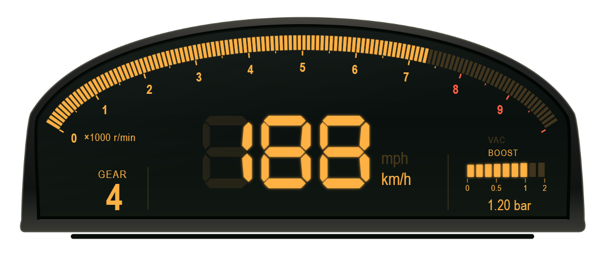
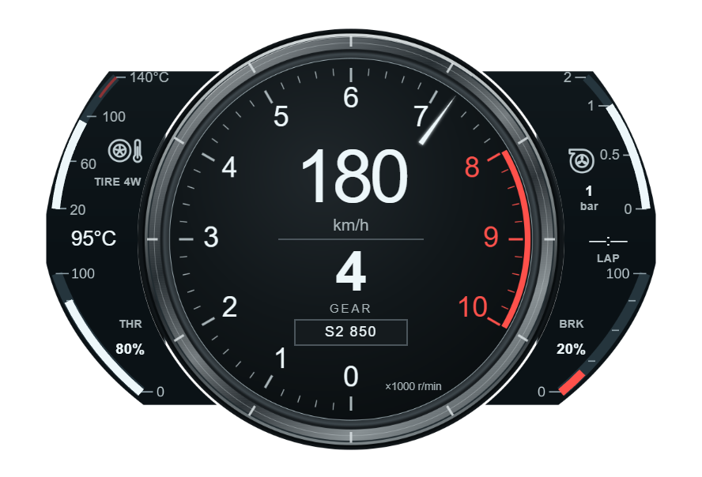
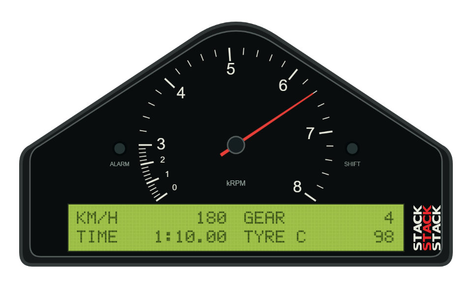
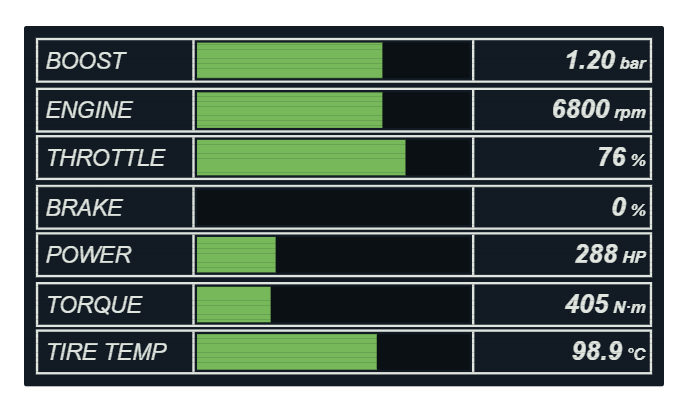

<h1 align="center">FH6-HorizonTuner</h1>

<p align="center">
  <strong>《極限競速：地平線 6》的遙測、調校與 HUD 工作台</strong><br>
  觀察車輛動態、用實測資料調校，打造自己的賽車儀表。
</p>

<p align="center">
  <a href="https://github.com/eddie772tw/FH6-HorizonTuner/releases/latest"></a>
  <a href="https://github.com/eddie772tw/FH6-HorizonTuner/actions/workflows/ci.yml"></a>
  <a href="https://github.com/eddie772tw/FH6-HorizonTuner/releases"></a>
  <a href="LICENSE"></a>
</p>

<p align="center">
  <strong>繁體中文</strong> · <a href="README.en.md">English</a>
</p>

<p align="center">
  <a href="#readme-download">下載</a> ·
  <a href="#readme-quick-start">快速開始</a> ·
  <a href="#readme-features">功能</a> ·
  <a href="#readme-documentation">文件</a> ·
  <a href="#readme-development">開發</a> ·
  <a href="#readme-contributing">參與貢獻</a>
</p>

FH6-HorizonTuner 透過遊戲的 **Data Out UDP 遙測**接收車輛資料，整合即時儀表、四步調校流程、賽事紀錄與分析。Windows 版另提供可自訂的透明 HUD 覆蓋層，使用獨立視窗呈現，不注入遊戲程序。

桌面介面使用 Tauri、React 與 TypeScript；遙測接收、資料儲存與調校計算由 Rust 後端負責。

<a id="readme-screenshots"></a>

## 畫面預覽

| AP1 Rev Arc | LFA Center Ring |
| :---: | :---: |
|  |  |
| **Stack ST8100** | **R34 MFD** |
|  |  |

*以上為 v1.7.2 文件中的 HUD 離線示意，使用合成遙測，並非遊戲實機截圖。查看[圖片來源](docs/releases/assets/v1.7.2/README.md)與[完整圖集](docs/releases/v1.7.2.md)。*

<a id="readme-download"></a>

## 下載與版本選擇

**[前往最新正式版 →](https://github.com/eddie772tw/FH6-HorizonTuner/releases/latest)**

| 版本 | 適合用途 | 下載 |
| --- | --- | --- |
| **Windows Full** · x86_64 | 即時遙測、調校、賽事紀錄與分析、HUD | [安裝版](https://github.com/eddie772tw/FH6-HorizonTuner/releases/latest/download/FH6-HorizonTuner-Full-Installer.exe) · [可攜版](https://github.com/eddie772tw/FH6-HorizonTuner/releases/latest/download/FH6-HorizonTuner-Full-Portable.exe) |
| **Windows Lite** · x86_64 | 只需要即時遙測、HUD 與設定 | [安裝版](https://github.com/eddie772tw/FH6-HorizonTuner/releases/latest/download/FH6-HorizonTuner-Lite-Installer.exe) · [可攜版](https://github.com/eddie772tw/FH6-HorizonTuner/releases/latest/download/FH6-HorizonTuner-Lite-Portable.exe) |
| **Linux Full** · x86_64 | 在同一區網接收另一台裝置的遊戲遙測，進行調校、錄製與分析；不含 HUD、音訊頻譜及系統媒體整合 | [AppImage](https://github.com/eddie772tw/FH6-HorizonTuner/releases/latest/download/FH6-HorizonTuner-Full-Linux-x86_64.AppImage) |

- **Windows 可攜版組合包**：[下載 Full + Lite ZIP](https://github.com/eddie772tw/FH6-HorizonTuner/releases/latest/download/FH6-HorizonTuner-Portable-Bundle.zip)。解壓縮後執行所需版本，無須另下載後端。
- **執行環境**：Windows 需要 WebView2 Runtime；Linux 需要相容的 GTK／WebKitGTK 與 AppImage 執行環境。macOS 目前不支援，詳見[平台需求與限制](docs/guides/cross-platform-release.md)。
- **Android Companion（Beta）**：Android 13+，搭配持續運行的 Windows Full，支援 LAN QR 配對與 USB／ADB。目前正式 Release 未附 APK；建置與驗收狀態見 [Companion README](companion/README.md)。

> [!NOTE]
> 本頁描述 `main` 的功能。下載版本的功能與可用資產以該 [Release 說明](https://github.com/eddie772tw/FH6-HorizonTuner/releases)為準；建置通過不代表所有平台與遊戲情境均已完成驗收。

<a id="readme-quick-start"></a>

## 快速開始

1. **啟動 HorizonTuner**：選擇 Full 或 Lite；可攜版直接執行，安裝版依安裝精靈完成設定。
2. **啟用遊戲 Data Out**：進入遊戲的「設定 → HUD 與遊戲操作」，開啟資料輸出並填入下表。
3. **確認收到資料**：回到遊戲短暫駕駛，在應用程式的 Data Out 引導與即時遙測頁確認封包、車速及轉速有更新。

| 遊戲內設定 | 遊戲與工具在同一台 Windows 電腦 | 遊戲在另一台區網裝置 |
| --- | --- | --- |
| Data Out | `ON` | `ON` |
| Data Out IP Address | `127.0.0.1` | Data Out 引導顯示的接收電腦 LAN IP |
| Data Out Port | `8000`（預設） | 引導顯示的 UDP port（預設 `8000`） |

跨機連線時，兩台裝置需在同一區網，接收電腦的防火牆需允許該 UDP port。若已自訂連接埠，以引導畫面為準。**遊戲使用 UDP 遙測埠，不是 HTTP／MCP 的 `8001`。** 詳細步驟見 [LAN Data Out 設定](docs/guides/cross-platform-release.md#遊戲端設定)。

首次使用可先觀察即時遙測，再在 Full 的調校工作區完成車輛設定與量測。調校建議須由使用者在遊戲內手動套用。

<a id="readme-features"></a>

## 功能一覽

- **即時遙測**：檢視車速、RPM、馬力／扭力、增壓、駕駛輸入、G 值、四輪胎溫與懸吊行程；以圖表追蹤車輛動態。
- **四步調校流程**：從目標與車輛設定、底盤與輪胎、引擎量測與齒比，到設定驗證。支援 Road、Rally、Cross Country、Drift、Drag 等用途，依量測品質與可調能力提供結果。
- **Windows HUD 與編輯器**：提供 Classic JDM、S650、GT7、Retro VFD、R34 MFD 等風格，以及輔助儀表、音響面板與手把遙測卡片；可調整位置、縮放、色彩並匯入／匯出佈局。
- **錄製、分析與加速測試**：保存 SQLite 遙測紀錄，比較單圈與歷史 session，設定計時賽／漫遊路線閘門，進行非破壞性修剪與 0–100、0–200 km/h、1/4 英里加速計時。
- **CLI 與 AI 工具整合**：Rust `fh6-agent` 提供狀態查詢、遙測診斷與調校命令；localhost 唯讀 MCP 提供即時與歷史資料、車輛規格及求解工具。[CLI 指南](docs/guides/agent-cli-guide.md) · [MCP 設定](docs/guides/mcp-setup-guide.md)。
- **主題、多語言與更新**：Halfmoon、Swiss、Rhine Lab 三套設計系統，支援繁體中文、英文、日文及擴充語系；整合診斷主控台與具簽章驗證的 OTA 更新。

### 模型與實驗功能的範圍

| 功能 | 目前範圍與限制 |
| --- | --- |
| Road／Rally 與 AEGO | 以工程基準與合格量測求解；資料不足或目標無解時不產生推薦。參閱[調校文件](docs/tuning/README.md)、[底盤基準](docs/tuning/chassis-engineering-baseline-v1.md)與 [Road 起步模型](docs/tuning/aego-road-launch-v3.md)。 |
| EV | 支援單速／多速量測、證據保存重播與終傳比預覽；最佳換檔點、實際極速預測及部分實車驗收仍待完成。[EV 模型](docs/calibration/ev-foundation.md) · [證據生命週期](docs/tuning/issue-435-ev-completeness.md)。 |
| CVT | 已有能力選擇、採集與重播契約；尚未提供可套用推薦、終傳求解與 ratio preview。[CVT 說明](docs/tuning/cvt-foundation.md)。 |
| MoTeC 匯出 | 提供 CSV、i2 XML 範本及實驗性 `.ld`／`.ldx` ZIP；原生格式的 MoTeC i2 實機相容性仍待驗收。[賽事分析指南](docs/guides/race-analysis.md)。 |
| Android Companion | 共用遙測卡片與調校流程；Android HUD 延後，原生外觀及裝置體驗仍有待驗收項目。[實作邊界](docs/architecture/companion-implementation-boundary.md)。 |

<a id="readme-documentation"></a>

## 文件

從 **[完整文件索引](docs/README.md)** 依用途查找操作說明、架構與歷史紀錄。

| 我想要… | 文件入口 |
| --- | --- |
| 錄製賽事、比較單圈、匯出資料 | [賽事分析](docs/guides/race-analysis.md) · [檔案匯出](docs/guides/file-exports.md) |
| 安裝自訂儀表或了解 HUD 欄位 | [自訂 HUD 套件](docs/guides/portable-custom-hud.md) · [R34 MFD](docs/hud/r34-mfd.md) · [Stack ST8100](docs/hud/stack-st8100.md) |
| 串接 Agent 或自動化工具 | [CLI](docs/guides/agent-cli-guide.md) · [MCP](docs/guides/mcp-setup-guide.md) |
| 研究調校公式與採集證據 | [調校開發](docs/tuning/README.md) · [校準流程](docs/calibration/README.md) |
| 開發介面、主題或後端 | [前端](frontend/README.md) · [設計系統](docs/frontend/design-systems.md) · [Rust 後端](docs/backend-rust/README.md) |
| 建置、發布或排查啟動問題 | [開發啟動](docs/guides/development.md) · [跨平台 Release／OTA](docs/guides/cross-platform-release.md) |
| 查找過去版本與研究 | [GitHub Releases](https://github.com/eddie772tw/FH6-HorizonTuner/releases) · [歷史文件](docs/archive/README.md) |

<a id="readme-development"></a>

## 從原始碼開發

以下為 Windows 開發流程。先安裝 **Git、Node.js 22、pnpm、Rust stable、MSVC Build Tools、Windows SDK 與 WebView2**；pnpm 版本請與 [CI workflow](.github/workflows/ci.yml)保持一致。Linux 建置請見[跨平台指南](docs/guides/cross-platform-release.md)。

```powershell
git clone https://github.com/eddie772tw/FH6-HorizonTuner.git
cd FH6-HorizonTuner
.\setup_dev.bat
.\dev_full.bat
# Lite 改用 .\dev_lite.bat
```

`setup_dev.bat` 準備依賴；日常以 `dev_full.bat` 或 `dev_lite.bat` 啟動，兩者一次執行一個。前端支援 Vite HMR，Rust 修改後需重新啟動。產品後端、MCP 與 CLI 不需要 Python；選用維護工具請使用 [Python 3.13／uv 環境](.agents/rules/python-uv.md)。

### 建置與驗證

建立 Windows Full／Lite 可攜版：

```powershell
.\setup_build.bat
.\build_all.bat
```

輸出為 `dist/FH6-HorizonTuner.exe` 與 `dist/FH6-HorizonTuner_lite.exe`。安裝包、OTA 簽章與正式發行另依[發行流程](docs/guides/cross-platform-release.md)處理。

依變更範圍執行對應檢查：

| 變更範圍 | 本地檢查 |
| --- | --- |
| 文件 | `git diff --check` |
| Rust 後端／CLI | `cargo test --locked --manifest-path backend-rust/Cargo.toml` |
| Rust 格式 | `cargo fmt --manifest-path backend-rust/Cargo.toml -- --check` |
| React／TypeScript | `pnpm -C frontend run test`、`pnpm -C frontend run build` |
| 無 HUD 平台 | 後端測試另加 `--no-default-features`，並依跨平台指南驗證 |
| Python 維護工具 | 依 [uv 規範](.agents/rules/python-uv.md)執行對應工具測試與 Ruff |

[CI Pipeline](https://github.com/eddie772tw/FH6-HorizonTuner/actions/workflows/ci.yml)執行自動檢查；[Host Diagnostics](https://github.com/eddie772tw/FH6-HorizonTuner/actions/workflows/diagnostics.yml)提供排程與手動啟動診斷。正式發行仍需對候選產物進行原生桌面 smoke test 與適用的遊戲／裝置驗收，不能以單元測試或離線圖片替代。

<details>
<summary><strong>專案結構與資料流</strong></summary>

```text
FH6 Data Out (UDP) → Rust backend → HTTP / WebSocket → Tauri / React / HUD
                                 → SQLite / MCP / Agent CLI

backend-rust/src/    遙測、儲存、API、MCP 與正式調校公式
frontend/src/        React 工作區、流程與顯示
frontend/src-tauri/  桌面視窗、後端生命週期與打包
hud_overlay/        Windows HUD renderer 與素材
companion/          Android 連線外殼與 WebView
lang/               語系字典
docs/               操作指南、契約與校準紀錄
scripts/            建置、發行與維護工具
```

正式調校決策由 `backend-rust/src/tuning/` 擁有，前端只處理流程、草稿與顯示轉換；舊 TypeScript 模型保留為測試參考。詳見[責任契約](docs/contracts/tuning_responsibilities.md)。

</details>

<details>
<summary><strong>連接埠、更新與資料位置</strong></summary>

| 用途 | 協定 | 預設值 |
| --- | --- | --- |
| 遊戲 Data Out | UDP | `8000` |
| 選用的原始遙測轉發 | UDP | `127.0.0.1:5300` |
| REST／WebSocket／MCP | HTTP／WebSocket | localhost `8001` |
| Vite 開發伺服器 | HTTP | `1420` |

開發模式固定使用 HTTP `8001`；Release 優先使用 `8001`，占用時改用可用的動態埠。實際端點見 Settings 的 MCP 區塊或資料目錄的 `logs/web_port.txt`。可透過 `TELEMETRY_PORT` 覆寫 UDP port；HTTP 與 MCP 保持 localhost，Companion 使用另外的授權配對入口。

Windows 安裝版與可攜版均內嵌 Rust 後端。可攜版優先在可寫的執行檔旁保存資料，受保護目錄則回退至 AppData。Full／Lite 安裝版各自獨立，OTA 分別使用 `latest.json`／`latest-lite.json`；Linux 使用 `latest-linux.json`。詳見[發行與資料路徑契約](docs/guides/cross-platform-release.md)。

</details>

<a id="readme-contributing"></a>

## 參與貢獻

歡迎回報問題、改善文件、翻譯與提交修正。

- **回報問題**：請在 [Issues](https://github.com/eddie772tw/FH6-HorizonTuner/issues)附上版本、作業系統、重現步驟及相關診斷資訊。
- **提交修改**：一般貢獻從 `main` 建立功能分支，使用 Conventional Commits，並在 PR 說明目的、變更與驗證結果。先閱讀[專案開發守則](.agents/AGENTS.md)及[測試策略](.agents/rules/testing-strategy.md)。
- **新增翻譯**：以 `lang/en-us.json` 為範本新增語系檔，於 `lang/iso639.json` 註冊名稱，確認鍵值完整且介面可切換。
- **維護文件**：涉及使用方式或架構的變更，請同步更新繁體中文與英文 README，詳細內容放在對應的 `docs/` 指南。

<a id="readme-security"></a>

## 安全性

發現安全漏洞時，請依 [SECURITY.md](SECURITY.md) 透過 GitHub Private Vulnerability Reporting 私密通報。

<a id="readme-license"></a>

## 授權與致謝

本專案採用 [MIT License](LICENSE)。Copyright © 2026 罐頭（eddie772tw）與貢獻者。

感謝 [Paburrito/forza-horizon-6-custom-hud](https://github.com/Paburrito/forza-horizon-6-custom-hud) 提供原始 Custom HUD 設計與靈感；外部素材與設計參考另見[參考專案索引](docs/reference-projects/README.md)及各功能文件。
