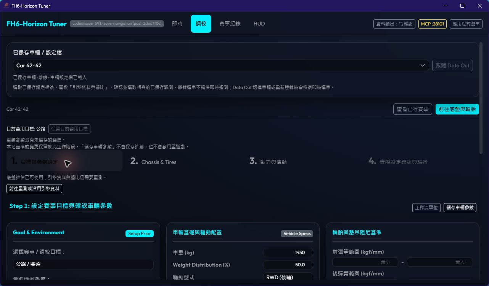
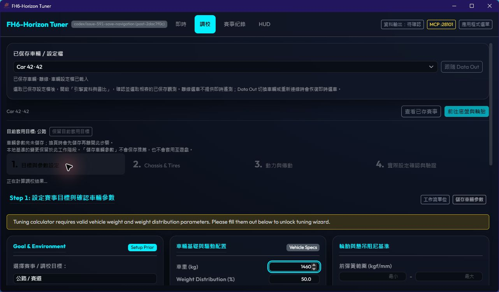
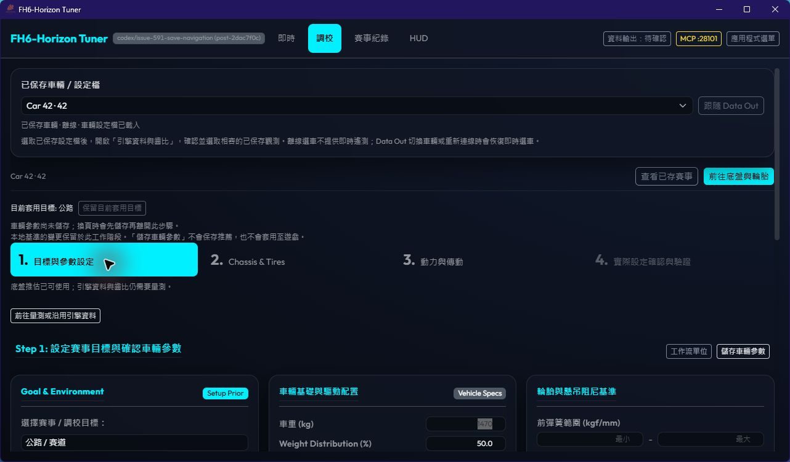
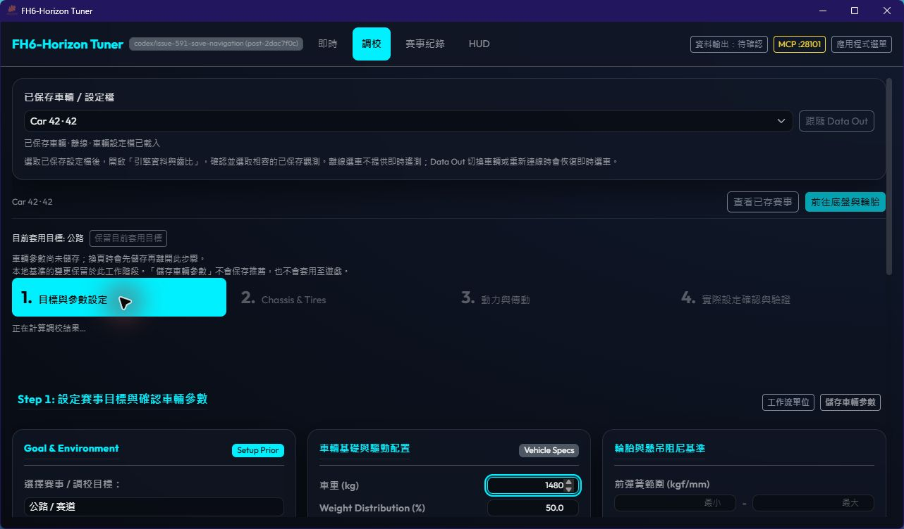

# Tune 保存與導航契約（#591）

## 操作對象

| 操作 | 保存／變更對象 | 是否前進 |
|---|---|---|
| Step1／Step2「儲存車輛參數」 | 當前車輛參數 | 否 |
| 前往下一步、上一步、步驟分頁、導引、歷史檢視 | 有未儲存參數時先保存；成功後才導航 | 是，或切換歷史檢視 |
| 套用本地基準／保留目前套用目標 | 工作階段的基準與目標草稿 | 否；不保存車輛參數 |
| ICE「儲存引擎資料並計算」 | 引擎觀測與收集影格，供 Rust 計算 | 否；結果可用後由頁首前往設定驗證 |
| EV「儲存參數並開始／重新收集」 | 先保存車輛參數，再開始收集 | 否 |
| Step4 非 Road「儲存推薦快照」 | 當前推薦及其輸入快照 | 否 |
| Step4 Road「建立基準 A」 | 推薦、量測輸入與賽事資料 | 進入 Road 驗證子流程 |

上述操作都不會自動把數值寫入遊戲。CVT 繼續遵守原有能力限制。

## 保存與非同步邊界

- 車輛參數的未儲存判斷由載入／成功保存的快照管理；背景 dyno 輪詢不使靜態參數變成未儲存。
- 相同快照的重複保存共用同一請求；保存期間的新修改仍標記未儲存，不會誤認已寫入。
- 各換頁入口共用保存流程；失敗時保留原頁、參數與重試操作。切換車輛、輸入、目標或量測身分後，舊請求不能觸發導航。
- 車輛參數、ICE 觀測、EV 操作、推薦快照、Road 及 CVT 的保存／操作期間阻擋 Tune 步驟導航。不同目標草稿仍須套用或取消才能前進；返回 Step1 可用。
- 保存狀態、未儲存狀態、已套用目標及計算狀態使用具語意的狀態區域；成功、失敗、重試不依賴短暫 toast。

## Step1 輸入抖動

數值編輯會重新請求 Rust workflow。原先 pending 時 readiness 暫時不可用，Step1 會插入缺少有效車重的 block alert，同時頁首導引消失；回覆後兩者反轉，造成表單位移。此路徑不會自動保存。

修正採用既有頁首狀態區域、保留導引空間，移除錯誤的 pending／缺少輸入混用。基準預覽只保留上一次實際高度作為重新計算期間的空白佔位；舊結果不留在 DOM，也不能套用。新的權威計算結果與 readiness 仍須等當前請求成功。

## 本機證據（2026-11-03）

Windows debug Tauri host 11.45.24、WebView2、實際 Rust sidecar；獨立暫存資料與合成 Car 42，未啟動遊戲。為檢查 UI Automation，驗證 host 使用 `--force-renderer-accessibility`；此為驗證程序參數，未寫入產品設定。

- 原生保存：車重 1350 → 1400，換頁後由 API 讀回 1400。
- 原生鍵盤：Shift+Tab 聚焦「上一步」，Enter 返回 Step1。
- 原生失敗與重試：獨占鎖定測試資料的 `car_params/42.json`，保存 1450 失敗時保留 Step1 與 1450，狀態區域明示錯誤；解除鎖定後重試成功並換頁，API 讀回 1450。
- 版面重現：只將 workflow HTTP 回覆延遲三秒；相同視窗、語言、資料與縮放下擷取 ready／pending。修正前有警告插入及導引移除；修正後表單位置維持一致。另於表單底部編輯後胎寬，確認預覽更新期間不縮短頁面而拉動輸入欄。
- UI Automation 可讀到保存結果、保留草稿／失敗提示與已套用目標。這不是實際 Narrator／NVDA 朗讀理解的人工驗收；該項仍待覆核。

| 階段 | Ready | Pending |
|---|---|---|
| #591 修改中、抖動修正前 |  |  |
| 抖動修正後 |  |  |

自動化入口：`CarParamsContext.save.test.tsx`、`TuningView.actions.test.tsx`、`TuneSessionProvider.baseline.test.tsx`、`useEngineMeasurementArchive.context.test.tsx`、`EvPowertrainStep.recovery.test.tsx`、`SetupVerificationStep.save.test.tsx`。移除換頁前保存防護時，七個入口案例皆失敗；保留原有 A→B→A 舊預覽不可見／不可套用的回歸。

Owner: Jonas as  Codex
