# Audio Head

[繁體中文](audio-head.md)

Audio Head is an independent HUD element that can coexist with any main gauge. Its fourth settings tab follows Main gauge, Telemetry cards and General. The panel uses shared workspace surfaces and theme tokens. Visibility can be off while settings remain editable; changes apply immediately and save automatically.

## Settings and compatibility

| Control | Field and range |
| --- | --- |
| Show Audio Head | `elements.showAudioHead`, off by default; independent of the gauge |
| Car Audio Head Unit Model | `audioHeadDeck`, 0–8; Pioneer DEH-P6100R by default |
| Audio Head scale | `audioHeadScale`, 50–200%; independent of gauge `scale` |
| Alignment | `audioHeadEdge`, left/right/top/bottom; centered on the left edge by default |
| Edge offset | `audioHeadOffset`, 0–4000 px inward from the selected edge |
| Center offset | `audioHeadCenterOffset`, −4000–4000 px along the edge; positive down/right |

The audio capture source remains in General. The launcher forwards the shared audio/media stream and latest snapshots to the gauge and independent Audio Head iframe. Changing settings tabs does not toggle HUD elements or recreate the runtime. Showing Audio Head again uses its saved model and position.

Only the ordered registry in `OverlayView` adds the `audio-head` entry; `HudWorkspace` contains no Audio Head logic. The panel receives a narrow configuration slice and shared actions, submits nested partial patches and keeps offset drafts across tab changes. Enter or ordinary blur commits; Escape restores the saved value. See the [extension contract](../frontend/hud-settings-workspace.en.md).

For existing audio configurations without `audioHeadScale`, frontend and Rust normalize before merging defaults: a valid legacy shared `scale` migrates once and is clamped to 0.5–2. An explicit invalid independent value becomes 1 instead of following the gauge again. Unrelated sparse configurations keep their fields and receive the 100% default. Legacy `hudStyle: "audio_head"` migrates to VFD plus the independent element, retaining visibility and explicit audio switches. Saving, reloading and partial updates preserve unknown fields.

## Settings visual review

Captured on 2026-11-04 from the production AppShell and React settings, 1280×720, Traditional Chinese. The fourth tab is named 音響系統 in this locale. Its controls remain editable while the element is hidden.

| Design system | Light | Dark |
| --- | --- | --- |
| Halfmoon Default | 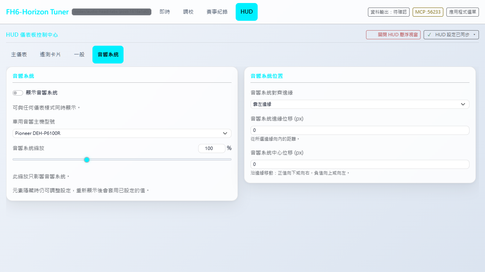 | 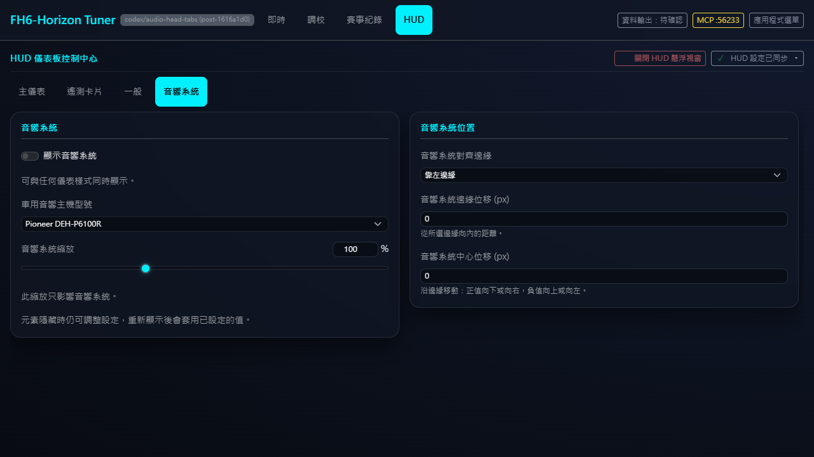 |
| Swiss Technical | 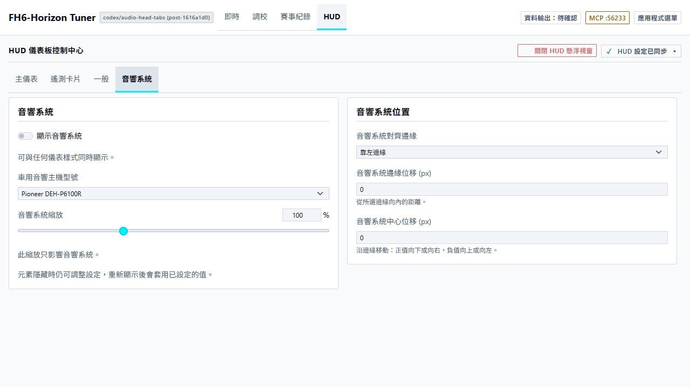 | 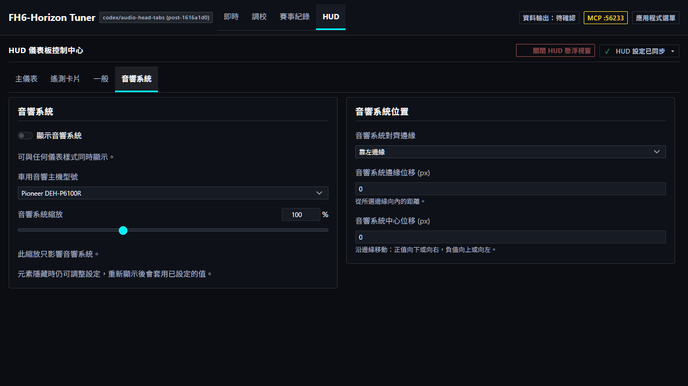 |
| Rhine Lab | 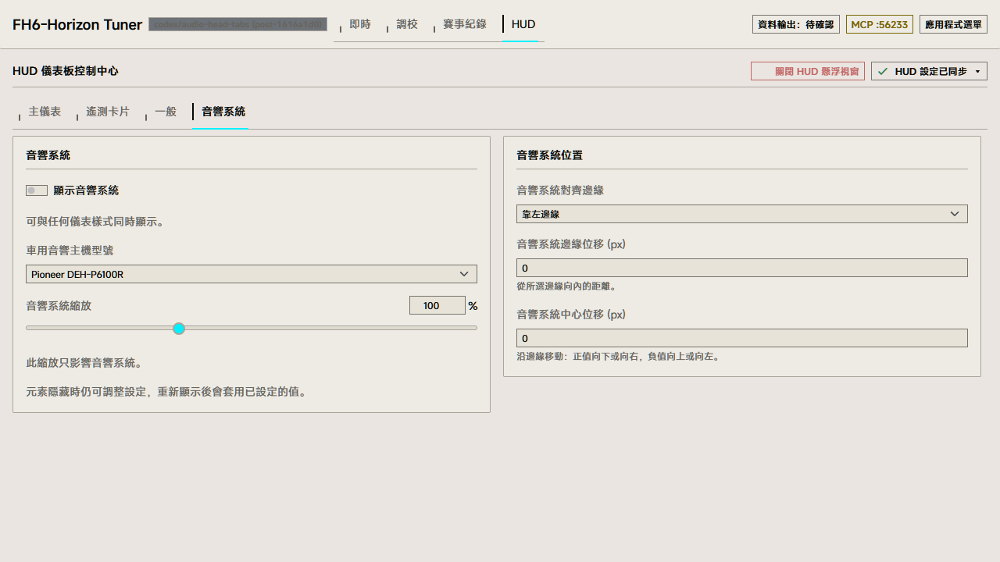 | 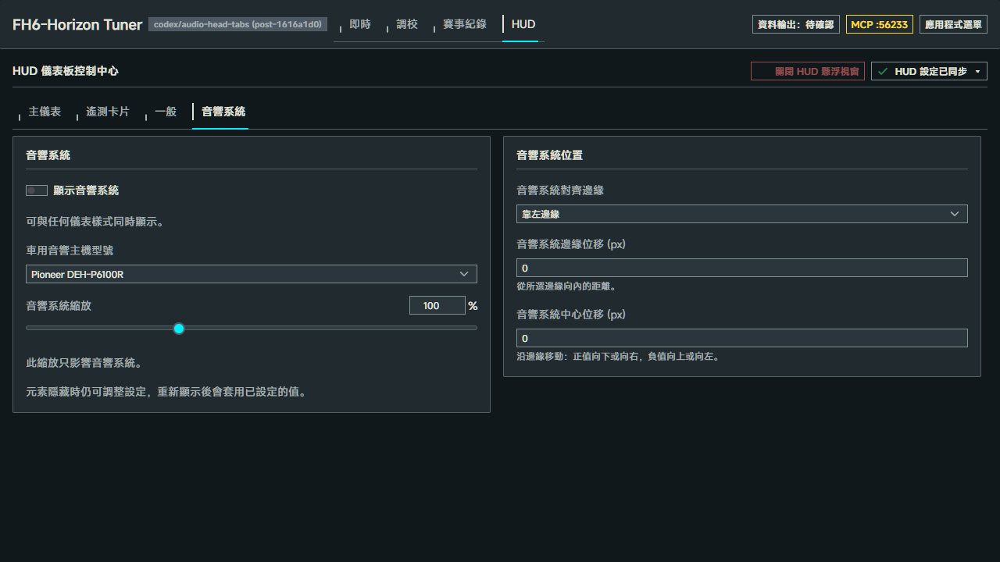 |

Other tabs and the narrow 320px layout

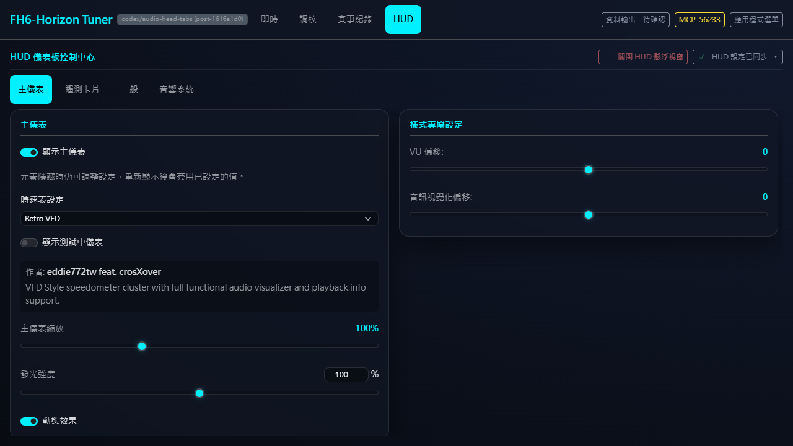

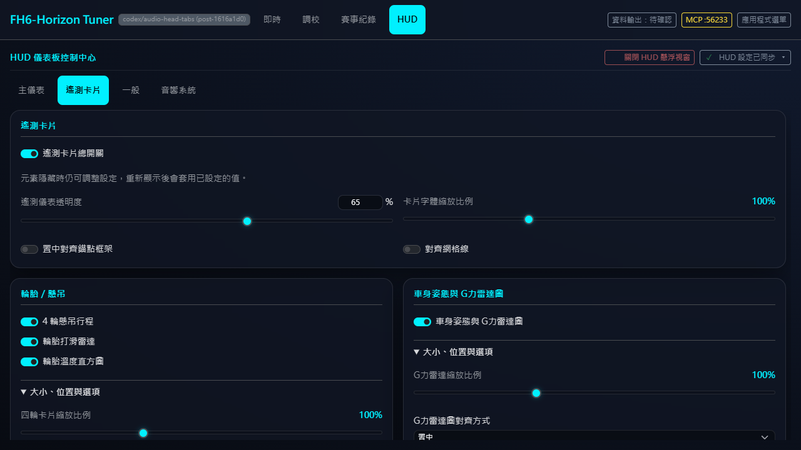

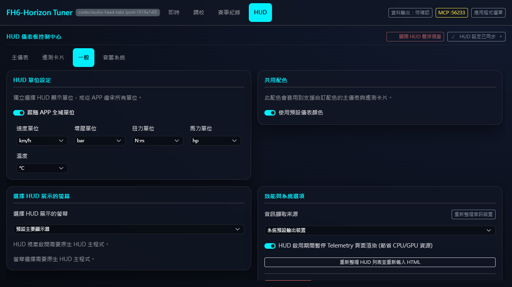

320×720 Audio Head tab; position controls are below the fold in the scrollable panel:

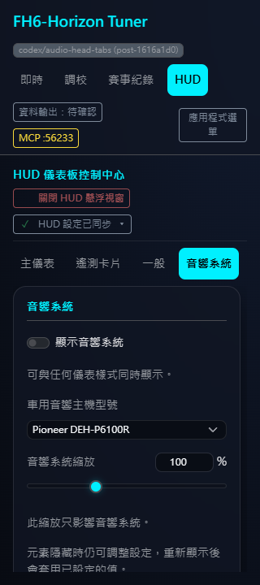

## All nine models

Each image is an element screenshot from the real HUD launcher and renderer after selecting the model in settings. Scale is 100%, DPR 1, with a neutral RGB(22, 27, 34) backdrop. Fixed synthetic WebSocket data supplies the spectrum and “HUD Demo - Night Drive” media text. The gauge and telemetry are hidden for unobstructed captures. Original rectangles, 75% background materials and separate decoration layers remain intact. See [asset documentation](../../hud_overlay/audio_head/assets/README.md) and [brand provenance](../../hud_overlay/audio_head/assets/brands/SOURCES.md).

1. **Pioneer DEH-P6100R**

   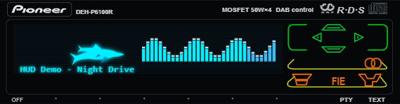

2. **Panasonic CQ-VX5500K**

   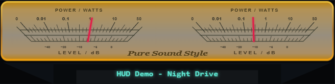

3. **Pioneer DEX-P1R**

   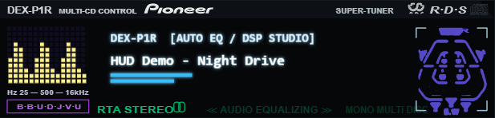

4. **Pioneer DEH-P835R**

   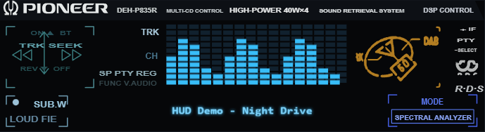

5. **Sony CDX-CA860X**

   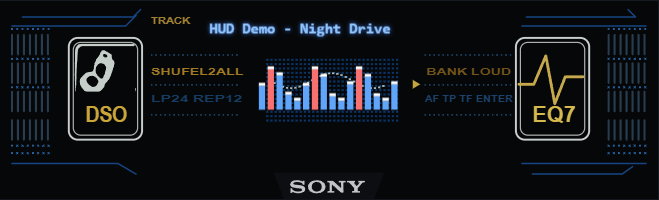

6. **Alpine CDA-7848**

   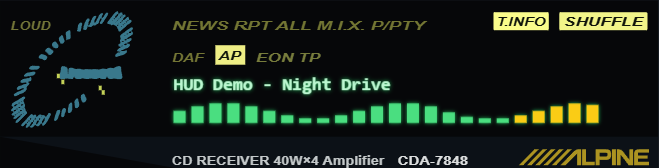

7. **Alpine CDA-9815RB**

   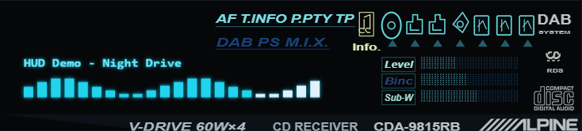

8. **Kenwood KRC-759R**

   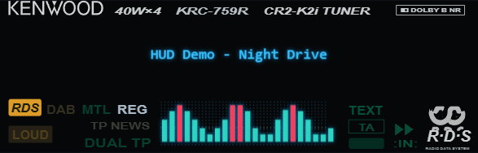

9. **JVC KD-LX50R**

   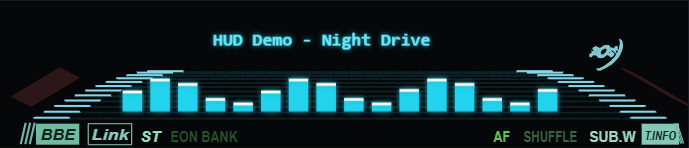

## Verification for this update

- Full frontend Vitest: 1,929 passed, one existing skip; TypeScript/Vite build passed.
- Rust defaults: 242 passed, three ignored; `--no-default-features`: 232 passed, two ignored.
- `node hud_overlay/audio_head/assets/build-panels.mjs --check`: all nine vector outputs match their editable sources. This integration does not change the faceplate assets.
- The separate R34/LFA/ST8100 settings browser contracts also pass on this update, retaining their gauge and CJK glyph assertions.
- Browser: 336 four-tab layouts (seven cores × light/dark × three locales × 1280/320px), plus 1920px, reduced motion and six specialized gauge forms. Keyboard/ARIA, drafts/scroll, hidden configuration, cross-tab writes, retry, unknown fields, reset and unit contracts pass.
- Real launcher: independent gauge/audio scaling, four-edge placement, nine live model selections and audio-only mounting/unmounting. The run recorded 62 fixture saves, 66 captures, no page errors and no unexpected API calls. This gallery selects 19 images; see [manifest](audio-head-screenshots/manifest.json) for checks, dimensions and SHA-256 hashes.

Run `node frontend/src/features/overlay_control/tests/browser/verify.cjs` with a task-local `PLAYWRIGHT_MODULE_PATH`, optionally `PLAYWRIGHT_CHANNEL=msedge` on Windows and `OUTPUT_DIR`. This runner invokes `hud_overlay/audio_head/tests/browser/verify.cjs`; browser checks remain outside Vitest.

These captures use isolated HTTP/WebSocket fixtures, with no user settings, real audio or game session. Windows native launch/display movement, in-game and Narrator/NVDA acceptance were not rerun for this update. The historical native evidence for #615 is not current #541 device acceptance.
