# 音響系統（Audio Head）

[English](audio-head.en.md)

音響系統是可與任何主儀表並存的獨立 HUD 元素。在 HUD 設定的第四個「音響系統」分頁選擇主機、縮放與位置；前面三頁依序為「主儀表／遙測卡片／一般」。所有表單沿用工作區共通面板與主題 tokens，關閉顯示時仍可預先設定，即時套用並自動儲存。

## 設定與相容性

| 控制項 | 設定欄位與範圍 |
| --- | --- |
| 顯示音響系統 | `elements.showAudioHead`，預設關閉，不影響主儀表 |
| 車用音響主機型號 | `audioHeadDeck`，0–8，預設 Pioneer DEH-P6100R |
| 音響系統縮放 | `audioHeadScale`，50–200%，獨立於主儀表的 `scale` |
| 對齊邊緣 | `audioHeadEdge`，左／右／上／下，預設左側中央 |
| X 軸位移拉桿 | 靠左 0–4000 px；靠右 −4000–0 px；靠上／下 −4000–4000 px |
| Y 軸位移拉桿 | 靠上 0–4000 px；靠下 −4000–0 px；靠左／右 −4000–4000 px |

位移拉桿每次 1 px，X 正值向右、Y 正值向下。對齊邊緣會將對應軸的向外方向鎖在 0；切換對齊時，超出新方向限制的值歸零，另一軸保留。拉動或按方向鍵即時套用，Home／End 到達該拉桿的上下限。儲存仍用原本的 `audioHeadOffset`（向內距離）與 `audioHeadCenterOffset`（沿邊位移），既有位置無須遷移。

音訊擷取來源仍由「一般」管理。主程式共用音訊／媒體來源，launcher 把最新快照轉送給主儀表及獨立 Audio Head iframe；切換設定分頁不會切換 HUD 顯示或重建 runtime。重新開啟音響系統會使用已保存的樣式與位置。

分頁只在 `OverlayView` 的有序 registry 加入 `audio-head` 項目；`HudWorkspace` 沒有音響專用邏輯。`HudAudioHeadPanel` 接受專屬設定切片與共用操作，使用巢狀局部 patch。X／Y 拉桿共用 `HudRange`，縮放數字輸入仍在切頁時保留草稿。詳見[分頁擴充契約](../frontend/hud-settings-workspace.md)。

舊音響設定尚無 `audioHeadScale` 時，前端與 Rust 都在合併預設值前從有效的共用 `scale` 遷移一次並限制於 0.5–2；明確存在但無效的獨立值回到 1，不再跟隨主儀表。未使用音響的稀疏設定保留原欄位，由預設值提供 100%。舊 `hudStyle: "audio_head"` 遷移為 VFD 主儀表加上獨立音響元素，保留原本隱藏狀態與明確的音響開關。儲存、重新載入與跨頁局部更新保留未知欄位。

## 設定頁視覺審查

2026-11-04，正式 AppShell 與 React 設定頁，1280×720、繁中。三種設計系統的日夜模式如下；展示靠右對齊、X 上限為 0 的拉桿，關閉音響時表單仍可編輯。

| 設計系統 | 日間 | 夜間 |
| --- | --- | --- |
| Halfmoon Default | 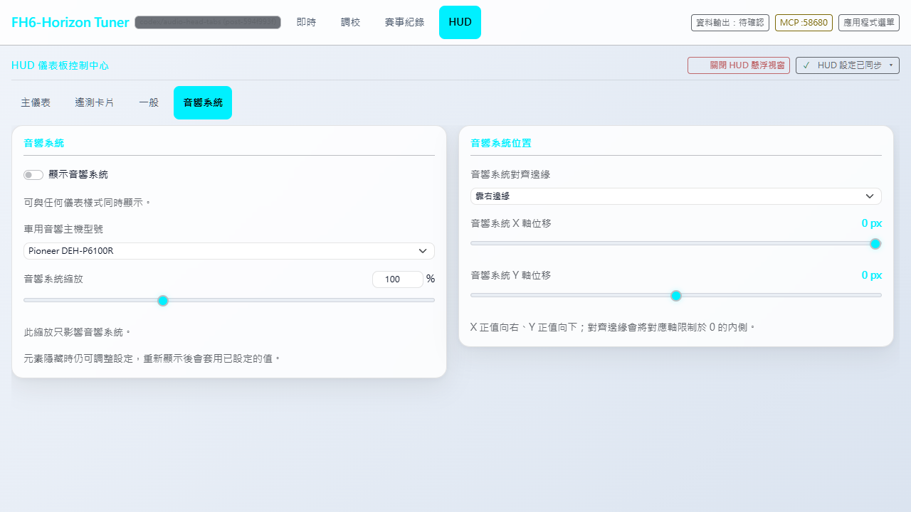 | 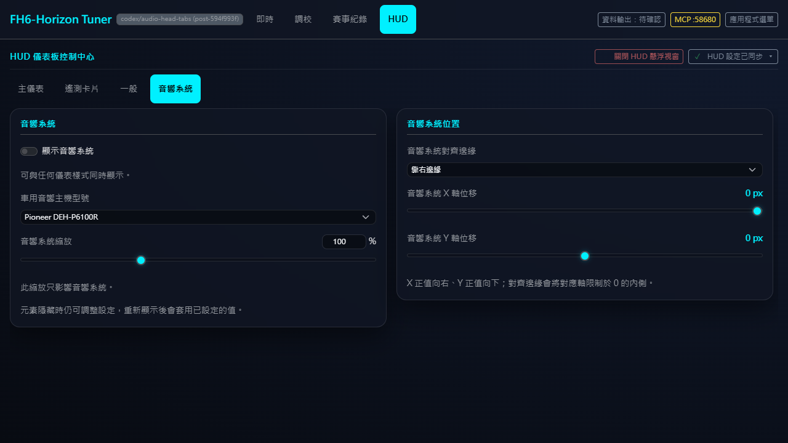 |
| Swiss Technical | 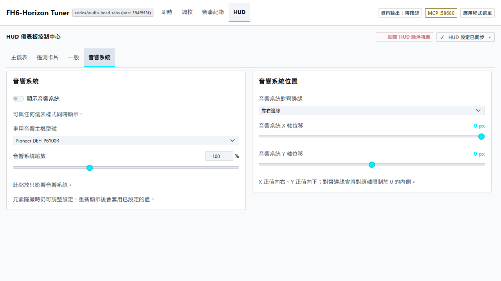 | 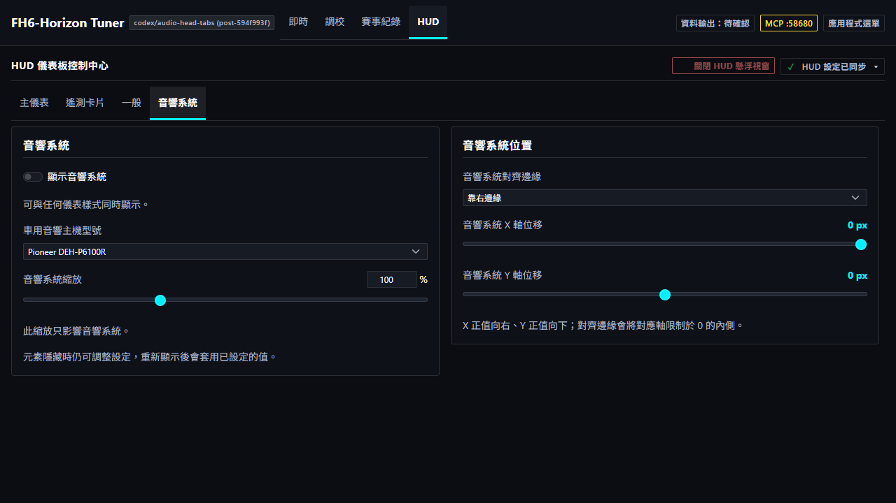 |
| Rhine Lab | 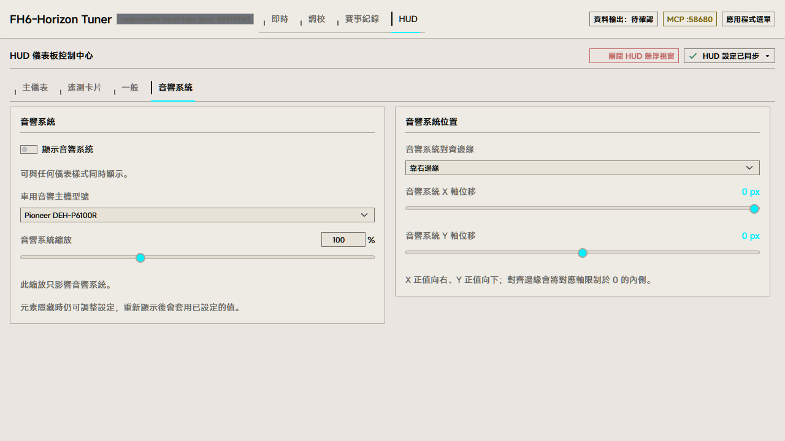 | 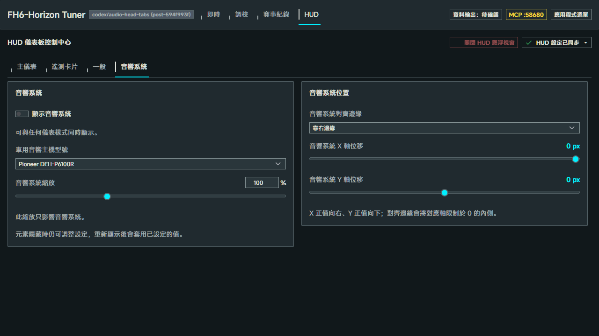 |

其他分頁與 320px 窄幅

主儀表：

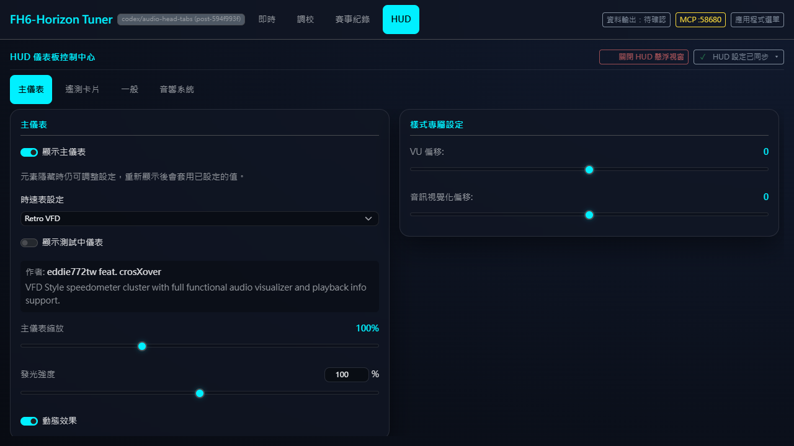

遙測卡片：

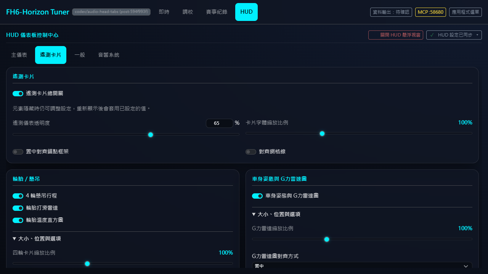

一般：

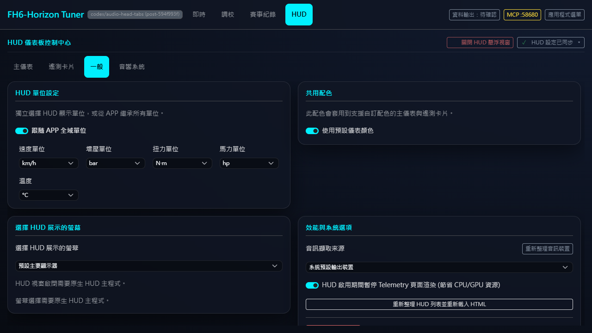

320×720 音響分頁，位置區位於可捲動內容下方：

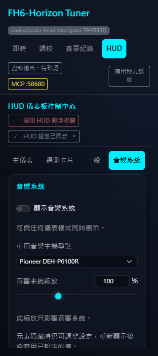

## 九款樣式

以下每張都由實際 HUD launcher 掛載 renderer，從設定頁切換型號後擷取元素；不是設計稿或重畫的截圖。縮放 100%、DPR 1，背景採中性 RGB(22, 27, 34)，曲名與頻譜來自固定模擬 WebSocket 資料「HUD Demo - Night Drive」。主儀表及遙測在擷取時隱藏，以免穿過半透明面板干擾審查。保留原始矩形、材質 75% 不透明度及獨立裝飾圖層；來源與重建方式見[素材說明](../../hud_overlay/audio_head/assets/README.md)及[品牌來源](../../hud_overlay/audio_head/assets/brands/SOURCES.md)。

1. **Pioneer DEH-P6100R**

   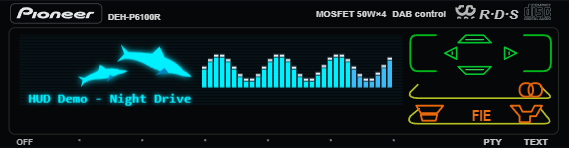

2. **Panasonic CQ-VX5500K**

   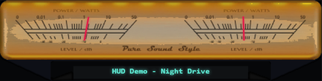

3. **Pioneer DEX-P1R**

   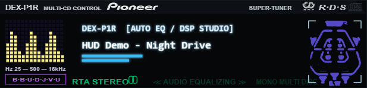

4. **Pioneer DEH-P835R**

   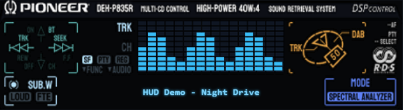

5. **Sony CDX-CA860X**

   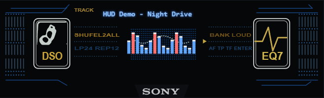

6. **Alpine CDA-7848**

   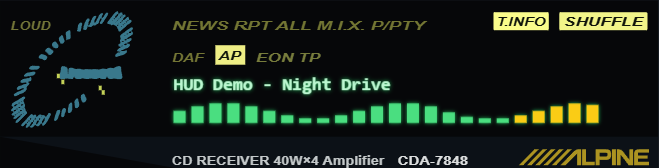

7. **Alpine CDA-9815RB**

   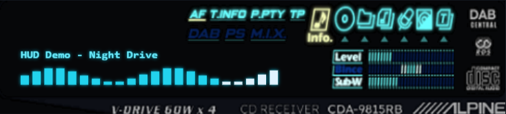

8. **Kenwood KRC-759R**

   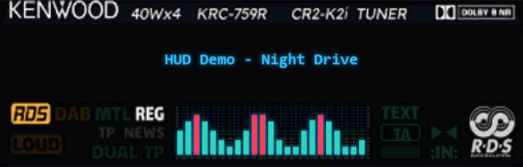

9. **JVC KD-LX50R**

   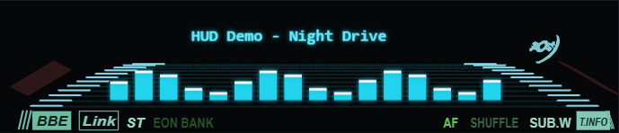

## 本輪驗證

- 位移拉桿修訂後完整 frontend Vitest：1,939 passed、1 個既有 skip；TypeScript／Vite build 與 `git diff --check` 通過。
- Rust 在整合版本 `594f993f` 驗證：預設功能 242 passed、3 ignored；`--no-default-features` 232 passed、2 ignored。本次拉桿修訂未改動 Rust、設定格式或 HUD renderer，未重跑 Cargo。
- 向量產物 `node hud_overlay/audio_head/assets/build-panels.mjs --check`：九款與可編輯來源一致，本輪未修改面板素材。
- R34／LFA／ST8100 各自的獨立設定頁瀏覽器契約在 `594f993f` 通過，保留儀表與 CJK 字形斷言。本次音響拉桿修訂由下列設定頁／launcher 瀏覽器腳本驗證。
- 瀏覽器：336 組四分頁版面（七個核心 × 日夜 × 三語 × 1280／320px），另含 1920px、reduced motion、六款儀表專屬表單；分頁鍵盤／ARIA、草稿與捲動保留、關閉後設定、跨頁保存、失敗重試、未知欄位、重設及單位契約。
- 實際 launcher：音響／主儀表獨立縮放、四邊對齊、X／Y 拉桿向外鎖定與向內移動、九款即時切換及音響單獨掛載／卸載。共 90 次 fixture 保存、66 張擷取、零 page errors、零非預期 API；此圖集更新 19 張。摘要、尺寸與 SHA-256 見 [manifest](audio-head-screenshots/manifest.json)。

重現入口：`node frontend/src/features/overlay_control/tests/browser/verify.cjs`，以 `PLAYWRIGHT_MODULE_PATH` 指向任務專用 Playwright，Windows 可設 `PLAYWRIGHT_CHANNEL=msedge`，`OUTPUT_DIR` 指定輸出。音響契約由此 runner 呼叫 `hud_overlay/audio_head/tests/browser/verify.cjs`；瀏覽器腳本維持獨立執行，不混入 Vitest。

這些圖片與瀏覽器結果使用隔離 HTTP／WebSocket fixture，未操作使用者設定、真實音訊或遊戲。此次未重跑 Windows 原生啟閉／跨螢幕、遊戲或 Narrator／NVDA 驗收；#615 的歷史原生紀錄不當作 #541 本輪實機證據。
