# Auxiliary Gauges 截圖備查 / Screenshot evidence

2026-11-05；#540 原 head `d3b137f1` 合入 #541 `bb36cd68` 加第五分頁整合修訂，隨本輪 merge commit 提交。來源 SHA-256、原素材比對、環境及驗證結果見 [manifest.json](manifest.json)。

實際 AppShell／HUD launcher，Windows sandboxed Edge，隔離 HTTP／WebSocket fixture；設定頁 1280×720／320×720，HUD 元素裁切為 scale 100%、DPR1、中性深色背景。共用來源補圖為英文，其餘設定代表圖為繁中；完整版面驗證覆蓋全部七核心、日夜、三語及五分頁，共420組。

Original PNG faceplates, real renderer, synthetic values. These are browser captures, not game/native multi-monitor or screen-reader acceptance. Clarity experiments are excluded.

## 設定頁 / Settings

| 系統 | 日間 | 夜間 |
|---|---|---|
| default | 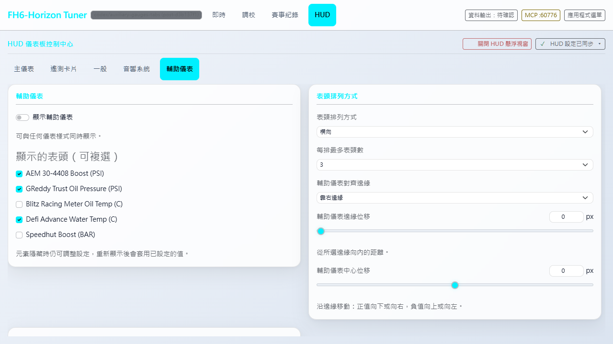 | 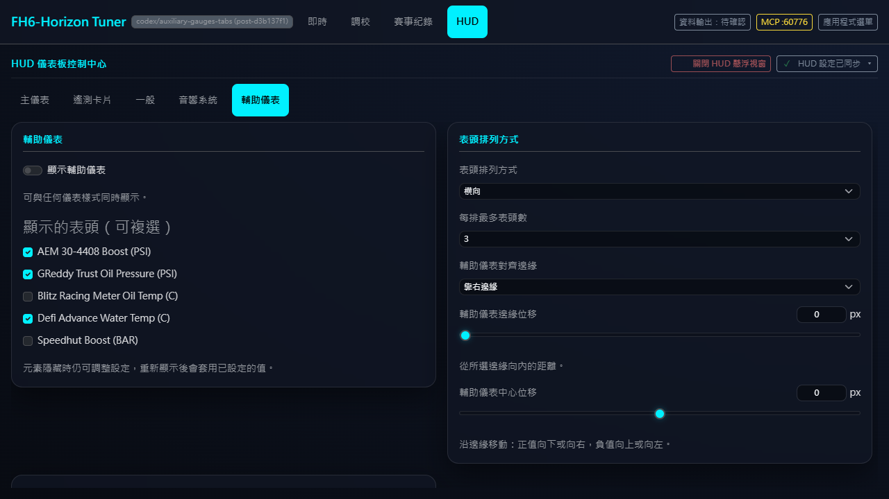 |
| swiss | 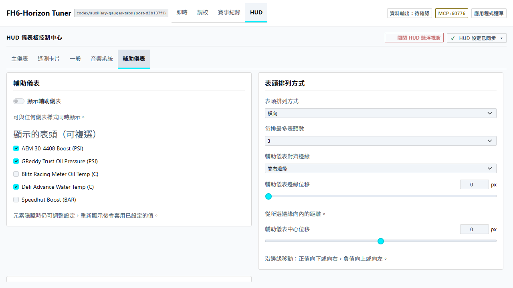 | 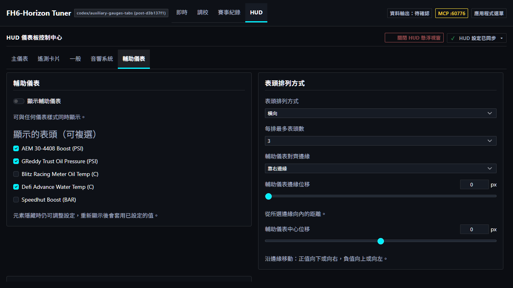 |
| rhine-lab | 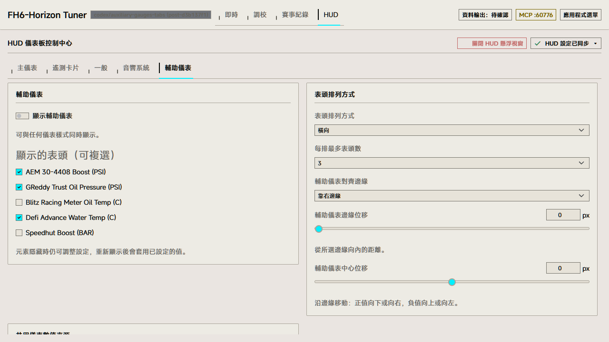 | 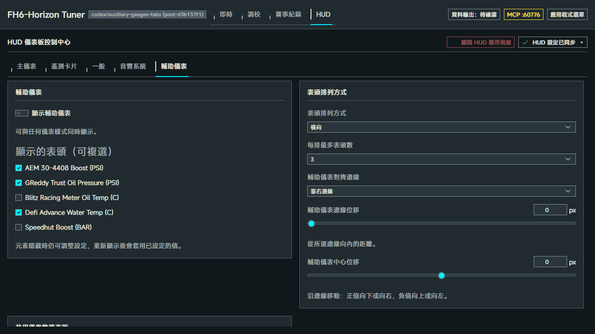 |

[320px 窄幅](default-dark-320-auxiliary-gauges.png) · [共用來源 / Shared sources](auxiliary-shared-sources.png)

其他四頁：[主儀表](default-dark-1280-gauge.png) · [遙測卡片](default-dark-1280-telemetry.png) · [一般](default-dark-1280-general.png) · [音響系統](default-dark-1280-audio-head.png)。均展示五分頁導覽；原有內容契約保留。

## 五款原素材表頭 / Original faces

### AEM 30-4408 Boost (PSI)

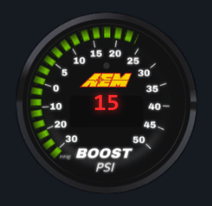

### GReddy Trust Oil Pressure (PSI)

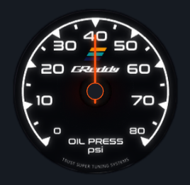

### Blitz Racing Meter Oil Temp (C)

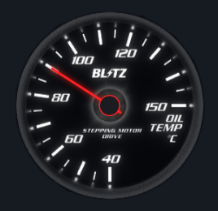

### Defi Advance Water Temp (C)

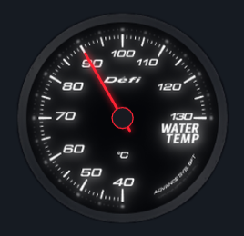

### Speedhut Boost (BAR)

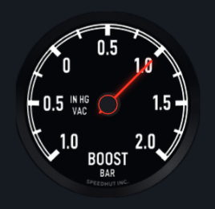

## 五表直向換排 / Five-face vertical layout

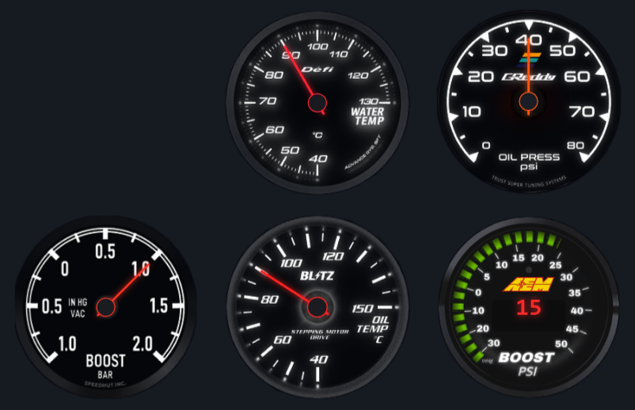

油壓在截圖中明確使用固定40的自訂來源，避免把阻尼動畫不同時間點當成差異；此為 fixture，不是真實油壓感測值。完整預設估計模型與來源轉換的純函式契約另有 Vitest 覆蓋。
