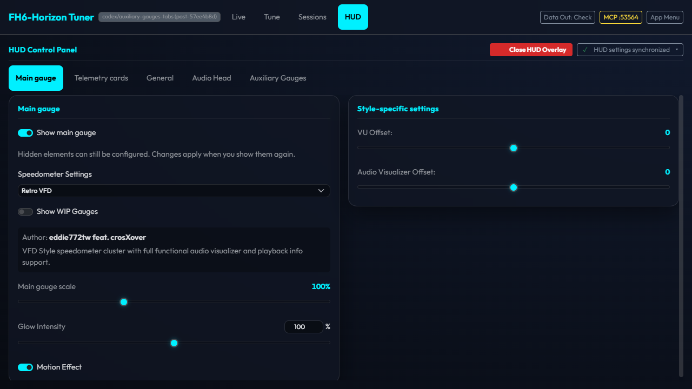
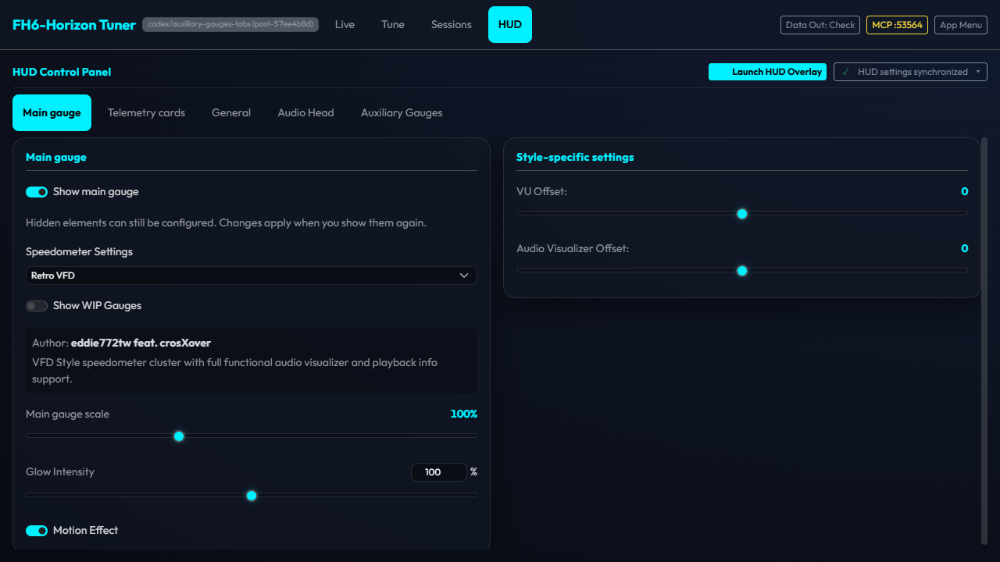
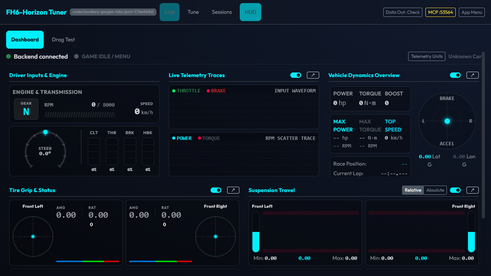
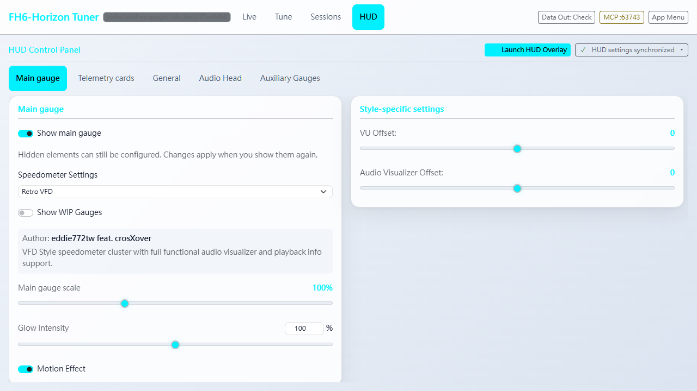
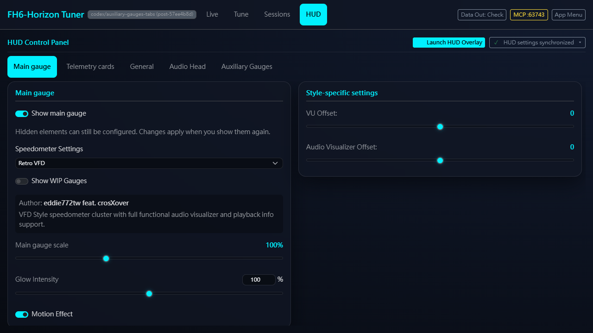
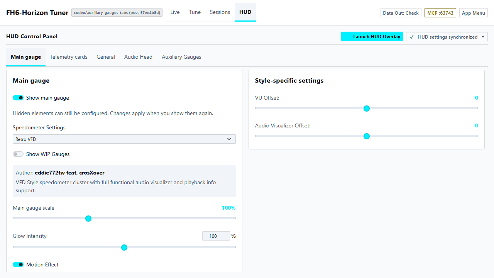
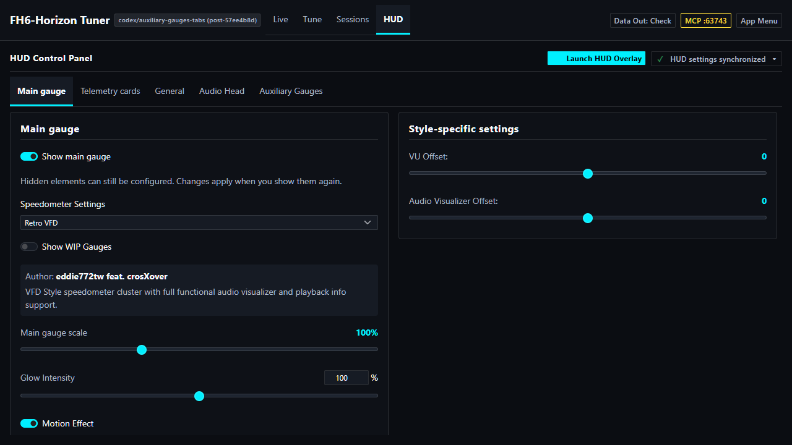
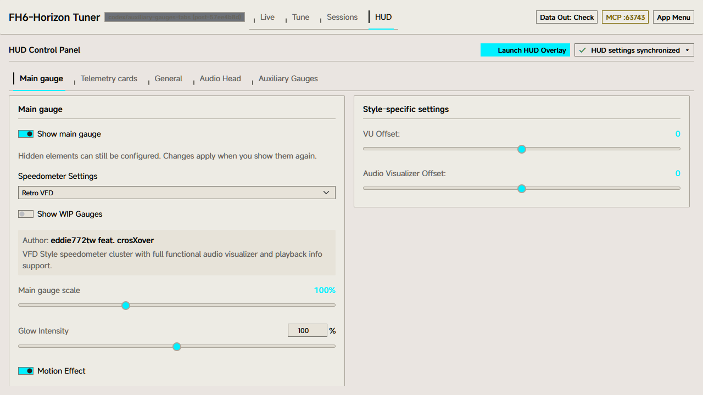
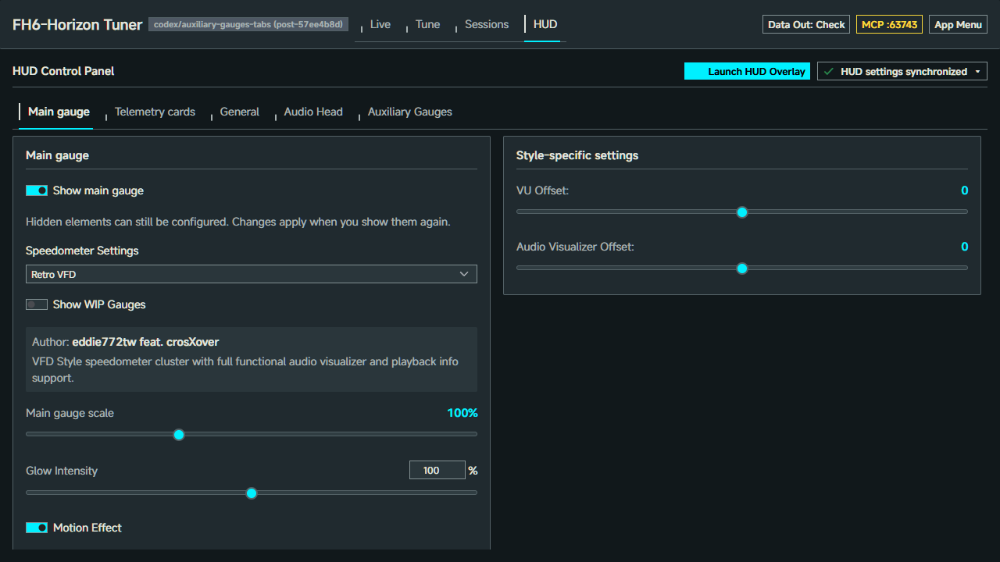
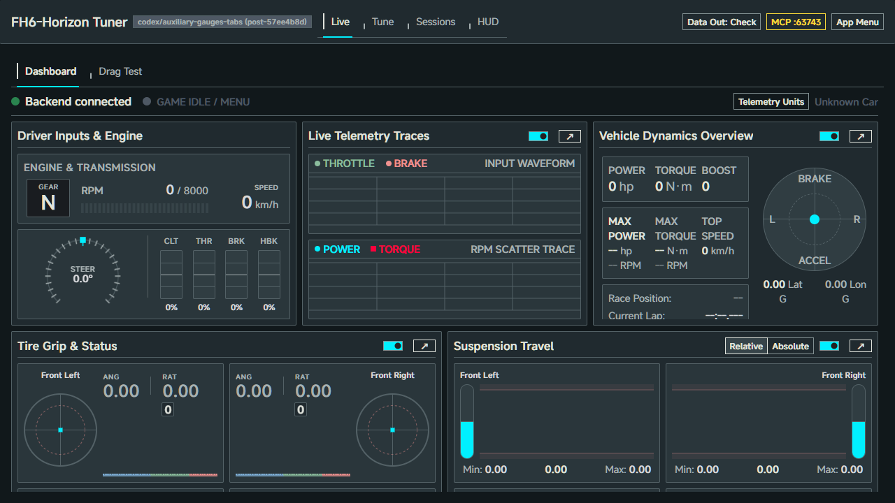

# HUD 重啟狀態修正 / Restart state correction

2026-11-05；擷取自 `57ee4b8d` 加本次狀態修正，隨修正提交。來源與圖片 SHA-256 見 [manifest.json](manifest.json)。原有18張表頭／分頁截圖的擷取版本不變。

## Windows 原生 / Actual native host

Windows Tauri debug host、WebView2 與真實 Rust backend，隔離資料／profile，1280×720、英文。先啟用真正的 HUD 視窗，再正常關閉 main 視窗並重新啟動程式。backend 刻意保持運作以保留 `enabled=true`；新原生 session 自動校正為 false，其他設定與未知欄位保留，Live 不被誤暫停。這不是遊戲、跨螢幕、音訊或讀屏驗收。

Actual Tauri/WebView2 host and real Rust HTTP backend, isolated user data. Normal main-window close and process restart reconcile the stale flag; other settings are preserved. No game or multi-monitor acceptance is claimed.







重現：先以 default features 建置 `backend-rust` 的 `server-sidecar` 與 `frontend/src-tauri` debug binary，於此 worktree 啟動 Vite（localhost:1420），再設定 task-local `PLAYWRIGHT_MODULE_PATH` 並執行：

```powershell
node frontend/src/features/overlay_control/tests/browser/verify-native-restart.cjs
```

腳本預設建立新的 scratch 目錄，僅啟動／關閉自己的 process，保存 report、log 與3張圖。`OUTPUT_DIR` 可指定專用輸出目錄。此實機 smoke 為獨立選用流程，不混入 Vitest。

## 瀏覽器 bridge fixture / Mock native bridge

下列7張使用實際 AppShell／runtime、隔離 HTTP 與模擬 native bridge，不是真正原生視窗。另驗證 WebView 頁面 reload 保留仍可見的 HUD、原生啟用失敗不保存 true、重啟修正與 Live 狀態。

| 系統 | 日間 | 夜間 |
|---|---|---|
| default |  |  |
| swiss |  |  |
| rhine-lab |  |  |



獨立重現：`HUD_SESSION_ONLY=1` 執行 `node frontend/src/features/overlay_control/tests/browser/verify.cjs`；完整瀏覽器流程亦包含此契約。
