# NFSU2 主儀表設定 / Main gauge settings

同步新版 HUD 分頁後，NFSU2 的11款面板選單位於「主儀表 → 樣式專屬設定」，不再使用已移除的進階設定面板。選項順序、`nfsu2Face` 數值與預設3保持相容；隱藏主儀表仍可預設，切頁不保存、不改顯示狀態。繁中、英文及日文使用同一份翻譯鍵。

The 11-face selector now lives under Main gauge → Style-specific settings. Face IDs, ordering and default value 3 remain compatible. Hidden gauges remain configurable and switching tabs does not save or change visibility. Traditional Chinese, English and Japanese labels are provided.

本次同步保留原 NFSU2 renderer、素材與 telemetry 語意。圖片與 [manifest](nfsu2-screenshots/manifest.json) 為2026-11-05實際 AppShell／launcher、sandboxed Edge、隔離 HTTP／合成遙測資料；不是遊戲、Windows原生、真實音訊或讀屏驗收。設定圖1280×720、三語窄幅320×720；表頭從實際 renderer 裁切，加中性背景，素材未修飾。

These are actual renderer captures with synthetic values, not game captures. This synchronization does not redraw artwork or change rendering semantics.

| 系統 / Theme | 日間 / Light | 夜間 / Dark |
|---|---|---|
| Default | 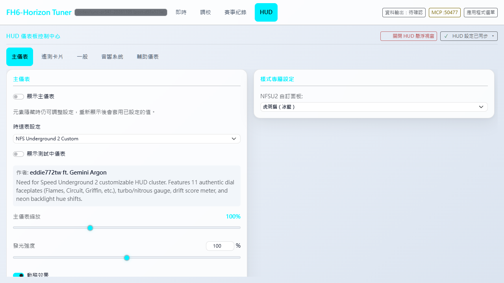 | 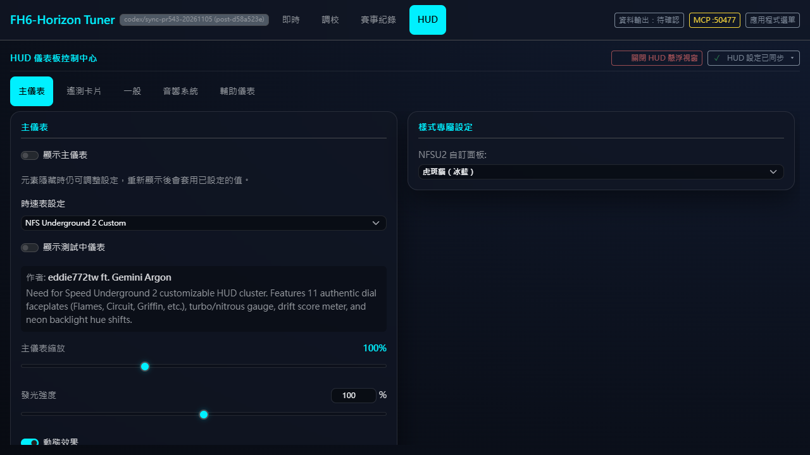 |
| Swiss | 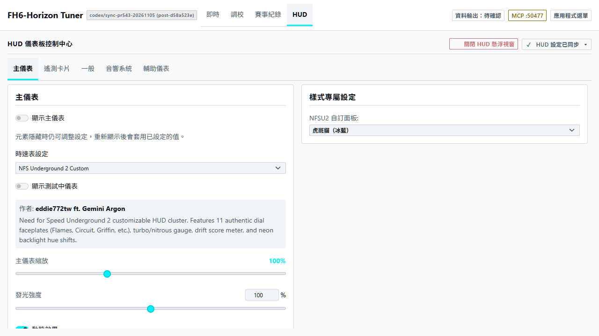 | 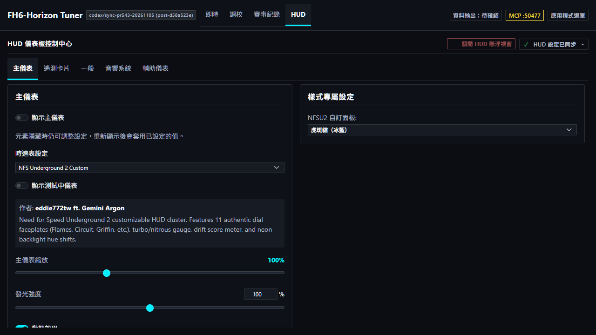 |
| Rhine Lab | 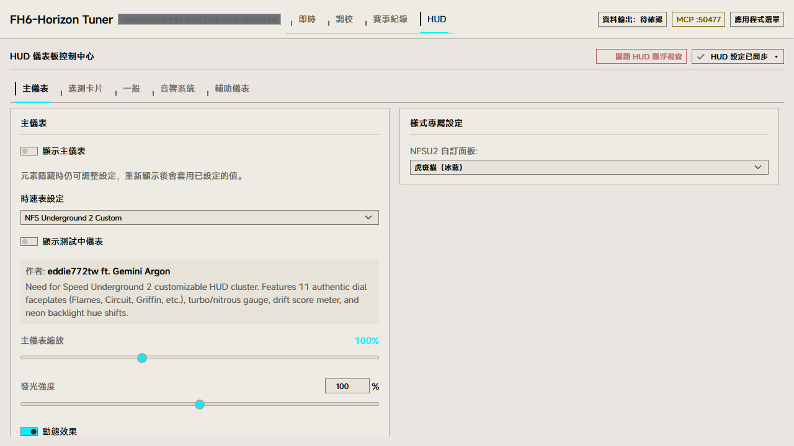 | 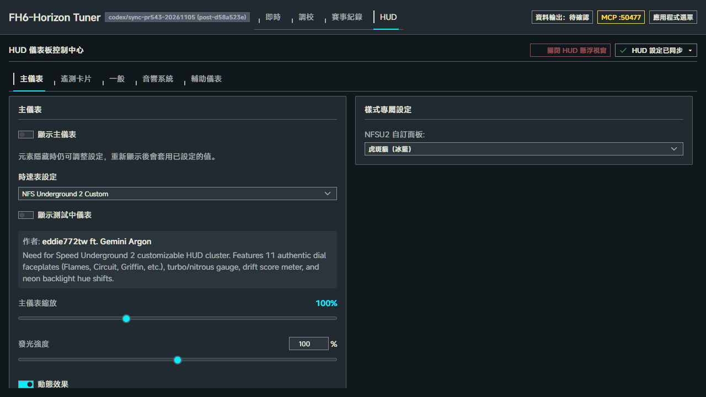 |

窄幅 / Narrow: [繁中](nfsu2-screenshots/nfsu2-settings-zh-tw-default-dark-320.png) · [English](nfsu2-screenshots/nfsu2-settings-en-us-default-dark-320.png) · [日本語](nfsu2-screenshots/nfsu2-settings-ja-jp-default-dark-320.png)。

## 十一款面板 / Eleven faces

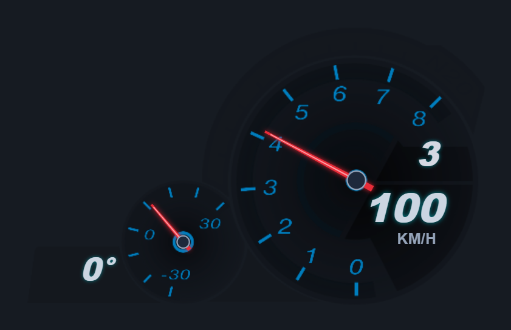
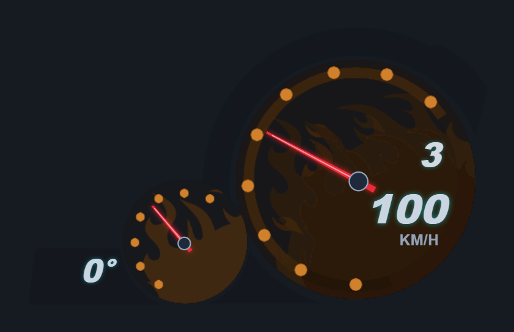
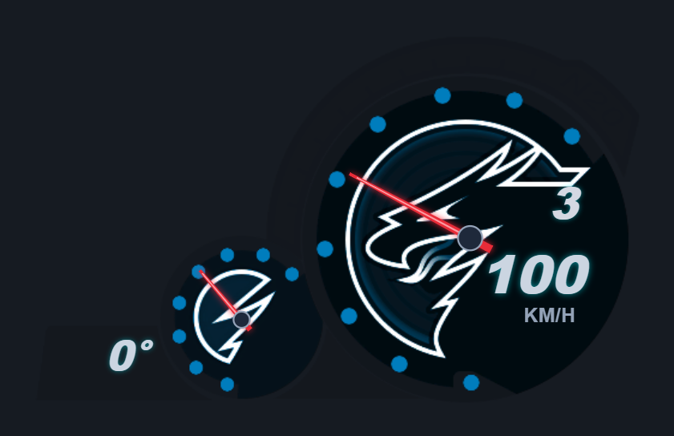
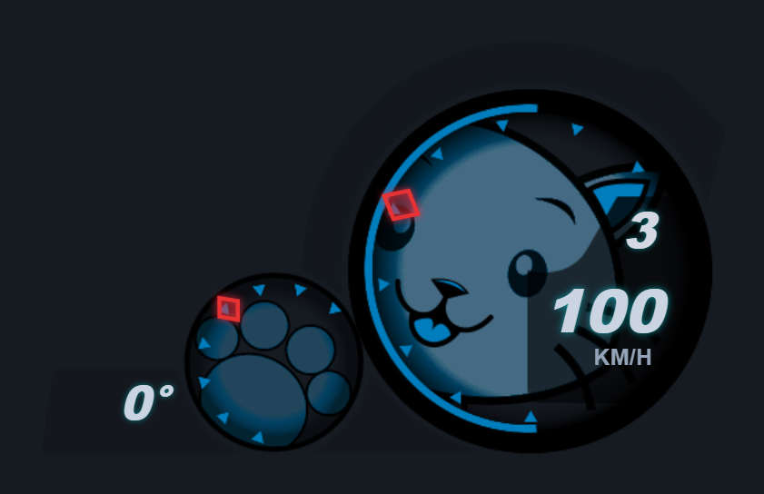
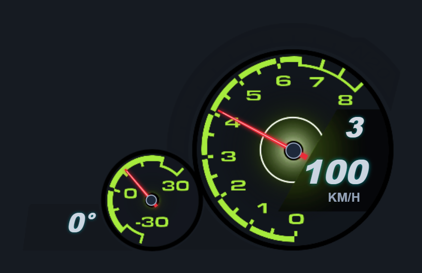
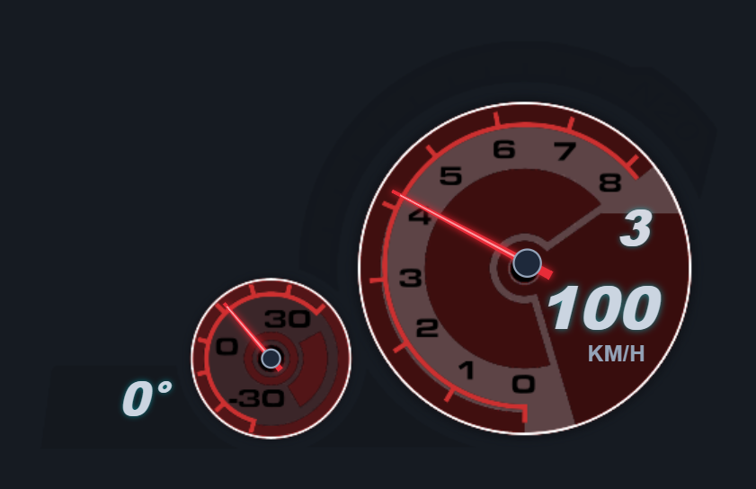
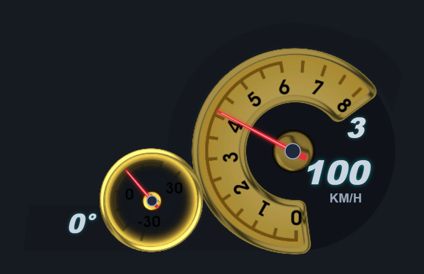
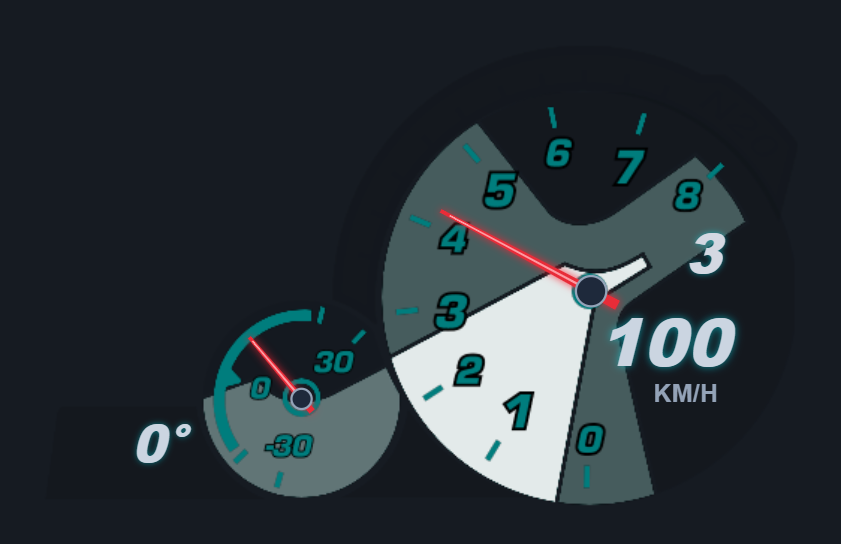
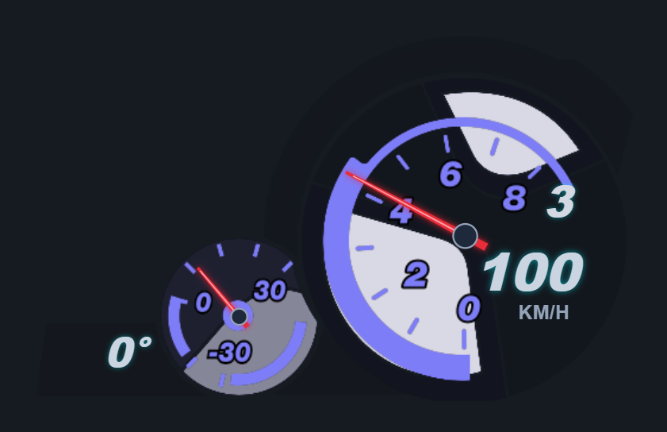
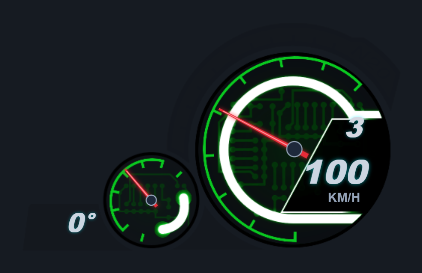
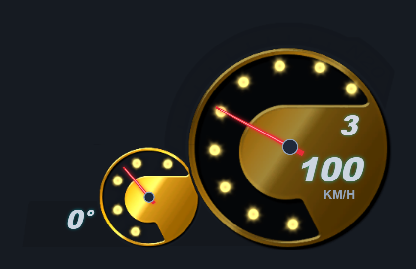

## 重現 / Reproduce

完整流程：`node frontend/src/features/overlay_control/tests/browser/verify.cjs`。單獨檢查本樣式時設 `NFSU2_ONLY=1`，同樣使用實際 AppShell／HTTP fixture。設定 task-local `PLAYWRIGHT_MODULE_PATH`；Windows 使用 `PLAYWRIGHT_CHANNEL=msedge`。涵蓋11選項、隱藏時編輯、切頁不保存、reload保存值，以及七核心×日夜×三語×1280／320px的84組專屬表單版面。啟動掃表動畫完成後才擷取固定遙測，避免把動畫時點當成素材差異。

The browser helper is opt-in and independent from Vitest. The original renderer telemetry unit contracts remain in the frontend test gate.
