# Aftermarket Tachometers 渲染圖

點選單錶裁切可查看 1920×1080 全畫面、HUD 縮放 100% 時的大小與位置。

| 轉速表 | 實際 HUD launcher 渲染 |
|---|---|
| AutoMeter Sport-Comp Monster | [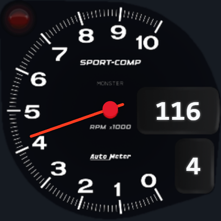](autometer_sportcom-1080p.png) |
| GReddy TRUST Sirius | [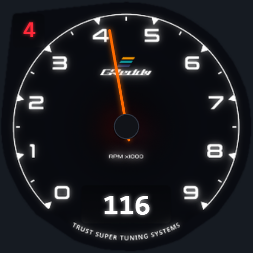](greddy_trust-1080p.png) |
| Blitz Racing Meter SD | [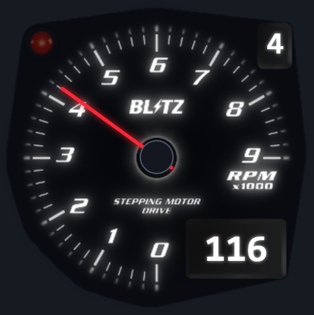](blitz_racing_meter-1080p.png) |
| Defi Advance BF | [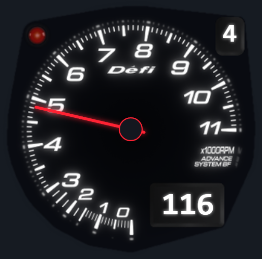](defi_advance-1080p.png) |
| Speedhut Datsun 240Z Classic | [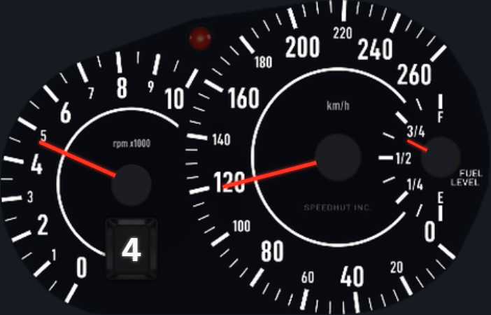](datsun_z_classic-1080p.png) |
| Speedhut Datsun 240Z Modern | [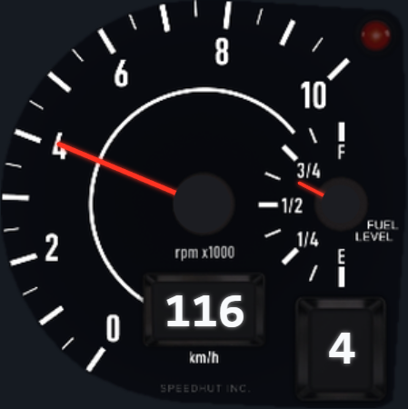](datsun_z_modern-1080p.png) |

## 擷取條件

2026-11-05，Windows、sandboxed Edge、DPR 1，中性背景 `#161b22`。以獨立資料目錄啟動真實 Rust backend，從 `/api/hud/styles` 確認六款內建儀表，逐一在「HUD → 主儀表」選取並確認保存，再擷取 launcher 載入的對應 iframe。等待啟動掃表結束後送入同一組合成遙測：116 km/h、4,200 RPM、四檔、65% 油量。每款皆檢查靜止及行駛時的畫布雜湊有變化，以及整個錶面位於 viewport 內。歷史 Forza 漫遊實拍的版本與環境另見 PR。

[Manifest](manifest.json) 記錄擷取版本、輸入、各款尺寸、畫布與 PNG 的 SHA-256。

擷取版本為 `f1547eab`，其中已整合 #535 與 #543。六款裁切及六張全畫面共 12 個 PNG，逐檔與原 #539 `a09fb9db` 在相同條件下的輸出相同。正式 backend 內建清單也包含 NFSU2 與四款 Toyota。

| 主儀表設定・繁中 1280×720 | 日間 | 夜間 |
|---|---|---|
| default | 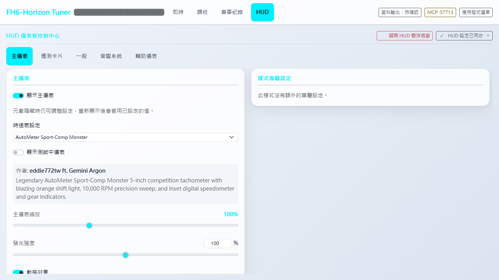 | 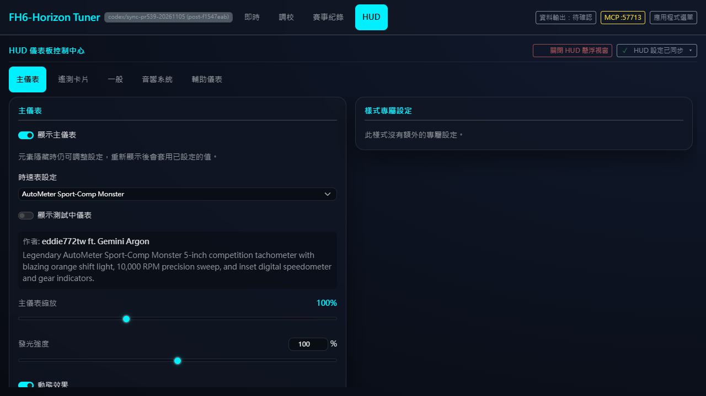 |
| swiss | 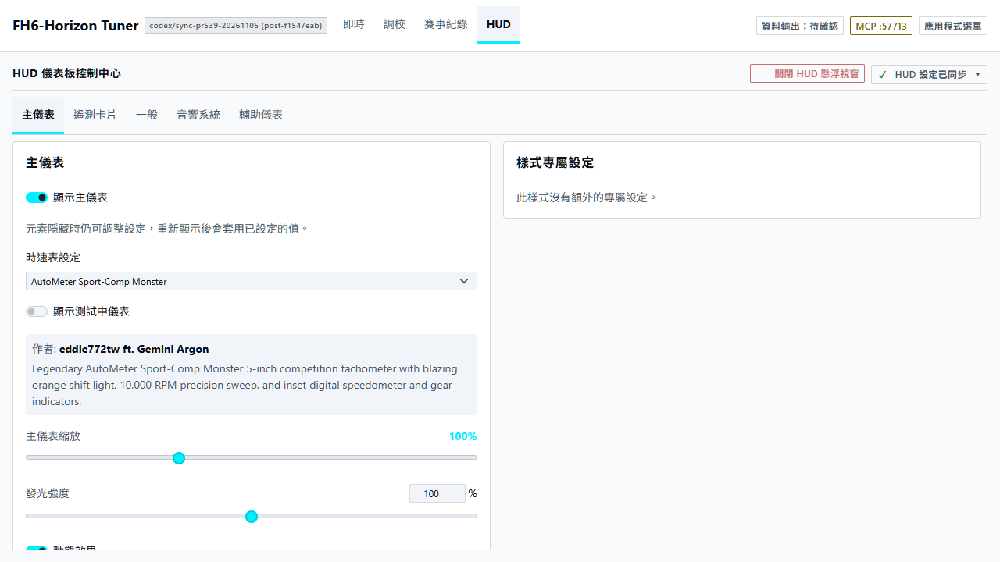 | 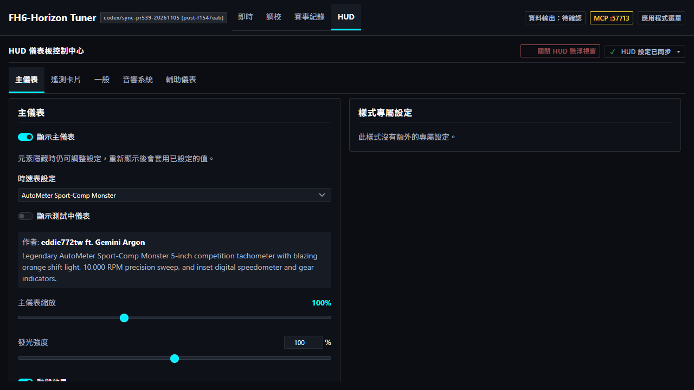 |
| rhine-lab | 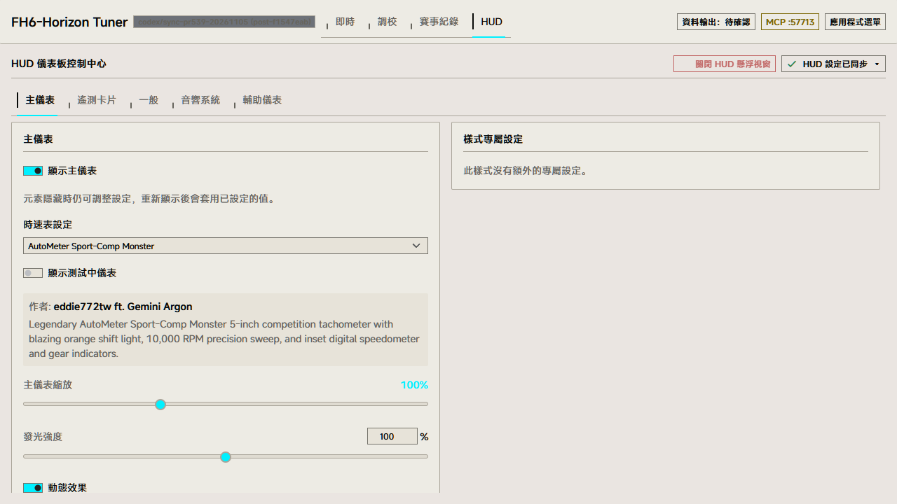 | 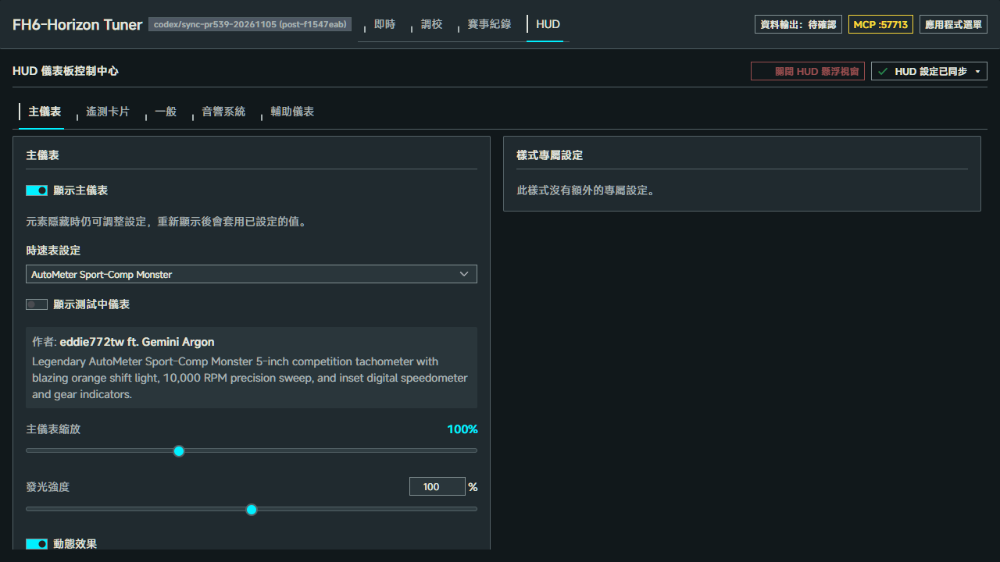 |

[320px 設定頁](settings-narrow.png)

## 重現

在安裝好前端依賴的 Windows worktree 中，將 `PLAYWRIGHT_MODULE_PATH` 指向工作區的 Playwright，再執行：

```powershell
cargo build --locked --manifest-path backend-rust/Cargo.toml --bin server-sidecar
node docs/hud/toyota-classic-screenshots/capture.cjs autometer_sportcom greddy_trust blitz_racing_meter defi_advance datsun_z_classic datsun_z_modern
```
