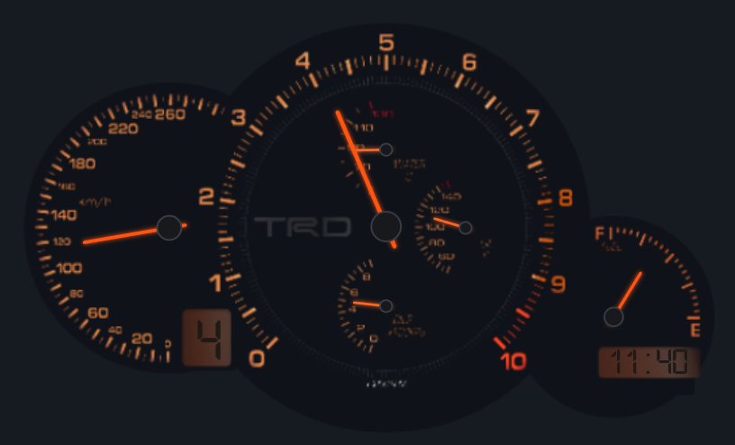
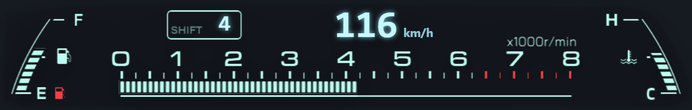
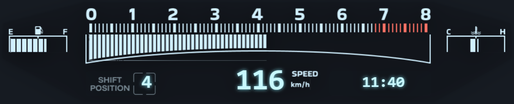
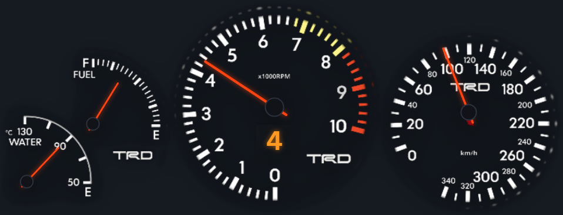
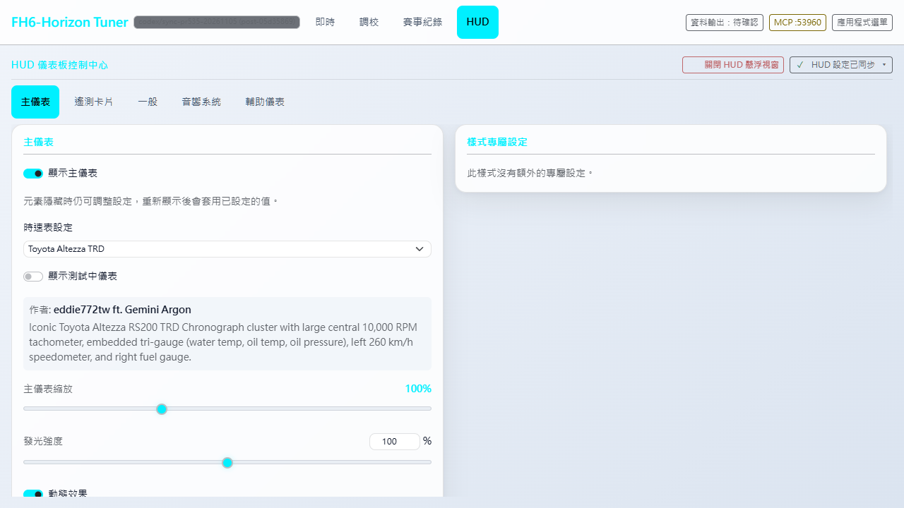
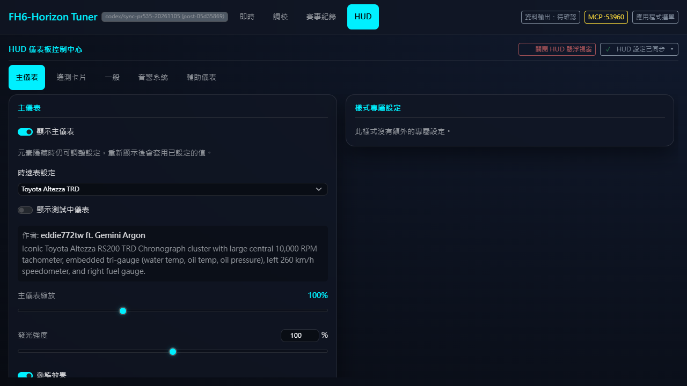
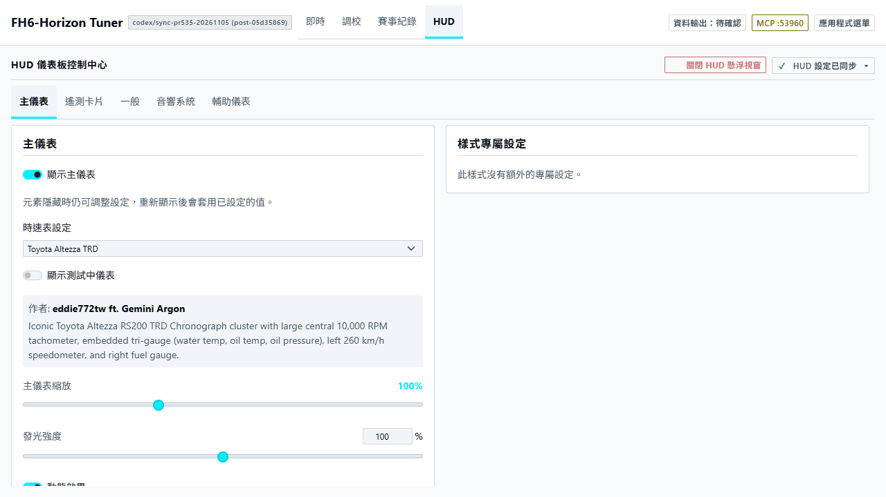
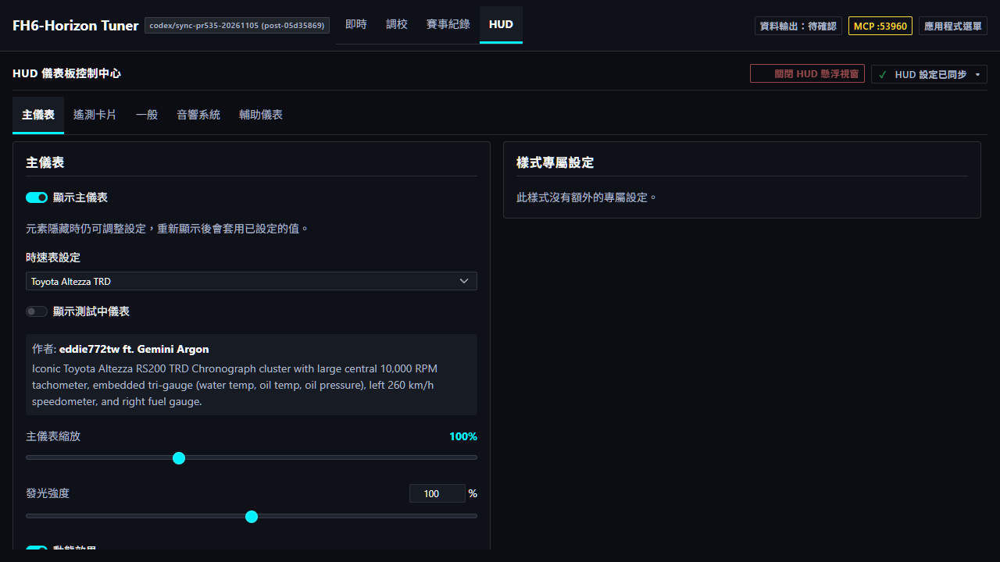
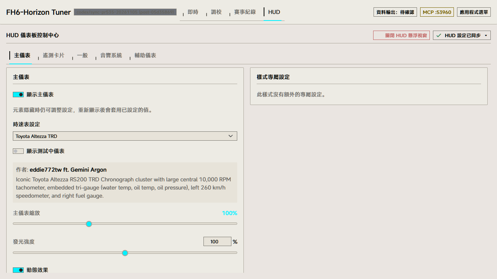
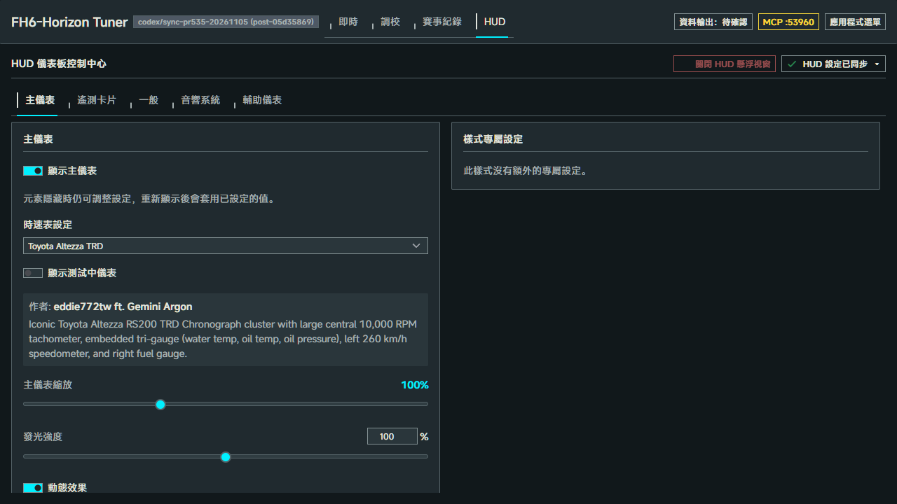

# Toyota Classic Dashboard 渲染圖

2026-11-05 於 #535 整合版本 `05d3586925ccaad94d5b1d84a6a8b303c1ec54d4` 擷取。每張錶面圖都來自在新版「HUD → 主儀表」選單切換後的實際 launcher。點錶面可查看原始 1920×1080 畫面，確認使用者在 100% 縮放時看到的大小與位置。

| 款式 | 實際渲染裁切（點擊看全畫面） |
|---|---|
| Toyota Altezza TRD | [](altezza_trd-1080p.png) |
| Toyota Chaser JZX100 | [](chaser_jzx100-1080p.png) |
| Toyota Soarer Z20 | [](soarer_z20-1080p.png) |
| Toyota Supra MK4 TRD | [](supra_trd-1080p.png) |

## 擷取條件

Windows、sandboxed Edge、DPR 1。Rust backend 以隔離資料目錄及動態 port 啟動，從正式 `/api/hud/styles` 確認四款皆登錄為 builtin。從 AppShell 選取款式後，先確認後端保存值，再從 `/hud/index.html` 載入的對應 iframe 擷取。HUD 使用原素材、既有 baseline 與共用 100% 縮放，中性背景為 `#161b22`。各款皆有 1920×1080 全圖和相同尺寸下的原始裁切。

掃表動畫結束後送入固定合成遙測，車速 116 km/h、4,200 RPM、四檔、油量 65%，四輪胎溫為 194／196／198／200 °F。水溫表沿用平均胎溫的換算值。各款從靜止切換到行駛資料時，Canvas 像素雜湊均改變，錶面完整位於 viewport 內。這批圖片的證據範圍為瀏覽器渲染與實際 Rust 設定保存；歷史遊戲實拍的版本與條件另列於 PR。

## 主儀表設定頁

繁中 1280×720，在三個設計系統下選取同一款 Altezza TRD。另附 [320px 窄幅](settings-narrow.png)。

| 設計系統 | 日間 | 夜間 |
|---|---|---|
| Halfmoon Default |  |  |
| Swiss Technical |  |  |
| Rhine Lab |  |  |

## 重現

Windows worktree 先安裝前端依賴，並將 `PLAYWRIGHT_MODULE_PATH` 指向 task-local Playwright。下列指令使用 default features 建置目前 checkout 的內建 HUD 素材，再啟動隔離 backend 與瀏覽器。圖檔與來源版本、輸入、畫面邊界及 SHA-256 寫入新的 scratch 目錄。

```powershell
cargo build --locked --manifest-path backend-rust/Cargo.toml --bin server-sidecar
node docs/hud/toyota-classic-screenshots/capture.cjs
```

本次檔案與渲染檢查詳見 [manifest.json](manifest.json)。
