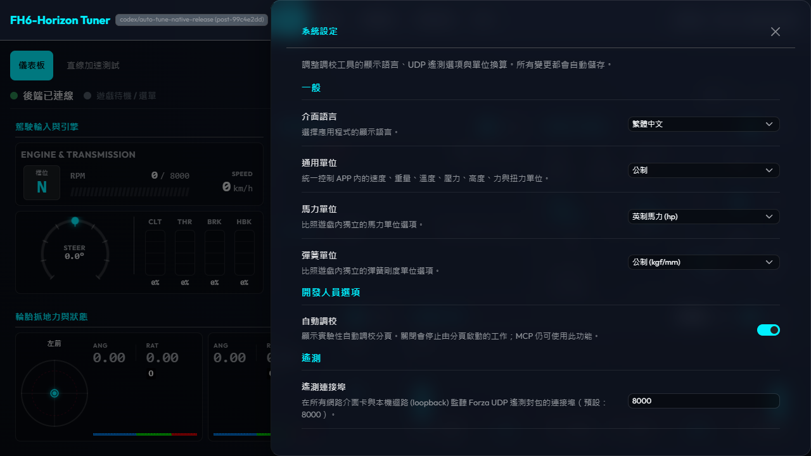
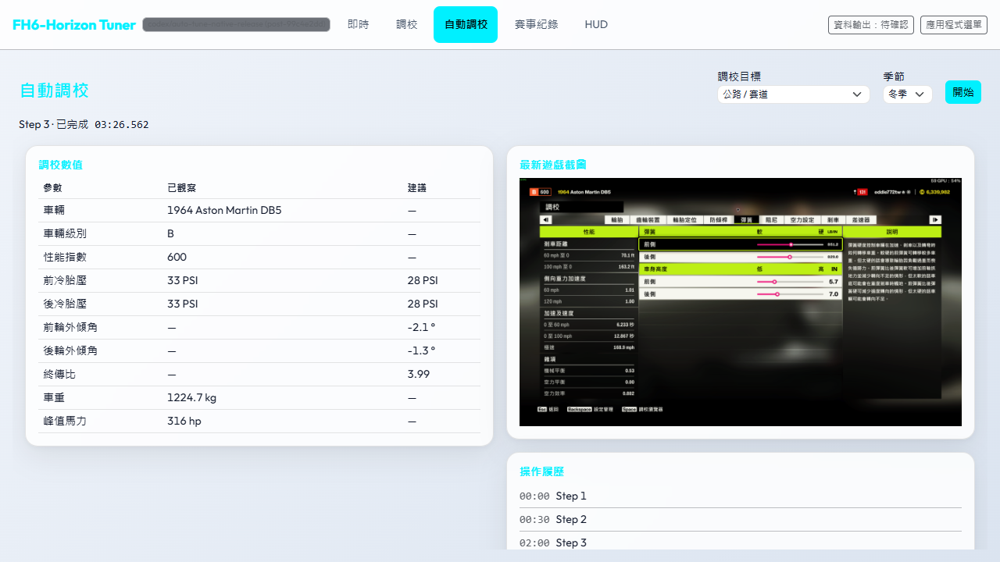
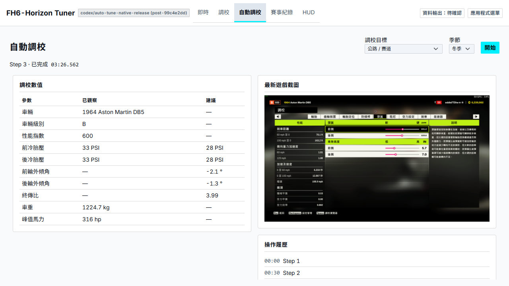
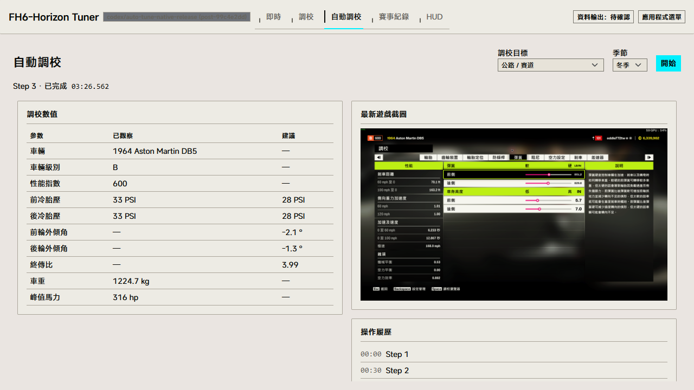
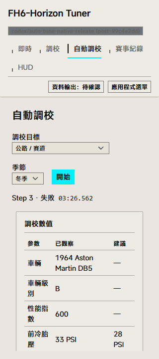
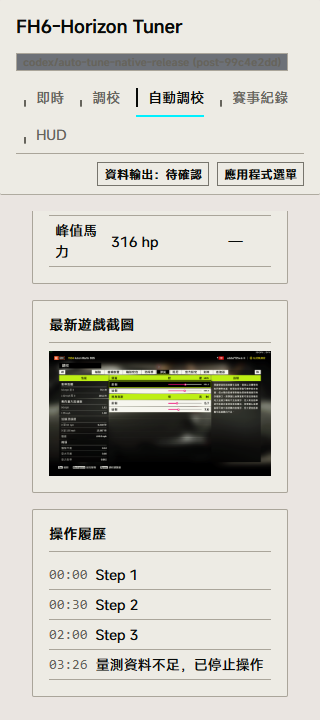

# 自動調校與開發人員選項視覺備查

使用正式 AppShell、設定 providers 及隔離的 Rust HTTP 後端擷取。自動調校 API 的工作狀態、數值及操作履歷使用明確的展示 fixture；最新截圖使用先前 DB5 測試的原始遊戲畫面。圖中的 206.562 秒是展示資料，不是本次原生 OCR／MCP 實機驗收計時。

重現入口為 [`scripts/capture_auto_tune_review.cjs`](../../../scripts/capture_auto_tune_review.cjs)。它啟動獨立資料目錄的後端與 Vite，以 Chromium headless 擷取；原生平台標記為 fixture，並不代表 WebView2 或讀屏驗收。日期、base commit、實際前端與語系 source SHA-256、瀏覽器版本、畫面輸入 hash 和逐例結果記錄於 [`manifest.json`](manifest.json)。擷取來源是該 base 加目前功能分支的未提交變更，以 source hashes 核對內容。

## 覆蓋

| 範圍 | 案例 |
| --- | --- |
| 共用分頁 | Default、Modern、Elegant、Swiss Technical、Swiss Editorial、Swiss Contrast、Rhine Lab，各日／夜模式 |
| 語言 | 繁體中文、英文、日文，依 manifest 分配 |
| 尺寸 | 1280×720；Default／Swiss／Rhine 的 320px 窄幅 |
| 狀態 | 未啟用、空白、執行中、完成、失敗、停止 |
| 設定 | Halfmoon／Swiss／Rhine 日夜代表圖；開發人員選項獨立段落與分頁開關 |
| 行為 | 關閉時隱藏實驗分頁、開啟後出現；保留既有 Tuning；無文件水平溢出、無頁面 JavaScript 錯誤 |

100% zoom、DPR 1、reduced motion。介面只呈現抓取值、建議值、最新畫面及操作履歷；設定中的分頁開關不限制 MCP 工具供應。跨車 OCR、離線 EXE 和遊戲 Step 1～3 的驗收證據需分開看，不能由這組展示 fixture 推論。

## 代表圖

開發人員選項獨立段落：

Halfmoon、Swiss、Rhine 的完成狀態：

窄幅失敗狀態保留錯誤和操作履歷：

交付前合入 main `31daaa55` 的 Altezza HUD，新增的語系鍵值及 HUD 設定來源與原擷取 hash 不同；自動調校／開發人員選項的元件、語系值及樣式未改。此圖集固定對應 `48af554c` 的介面來源，沒有將同步 main 後的 hash 回填成原擷取證據。
