# Issue #658 視覺審查備查

2026-11-12，Windows／Chromium 148.0.7778.96，實際 AppShell、導覽與 providers，DPR1、100% zoom、reduced motion。擷取版本為 #659 `8455856ba7ca590687847f8808f527214cf711ec` 加本輪獨立審查修正；[manifest](manifest.json) 固定558個產品來源檔 SHA256（UTF-8 文字換行正規化為 LF）與後端執行檔原始 bytes SHA256。後續只有文件整理時可沿用，產品來源必須與 manifest 相同。

## 範圍與結果

- 22案例：七core各日夜／1280×720，另以 Halfmoon Default、Swiss Technical、Rhine Lab 各做日夜／320×720，以及預設英文封存空狀態、載入失敗與重試。
- 50張PNG：三個代表core的寬窄日夜畫面，包含封存、完整封存面板裁切、設定及 Step3 遙測採集工具；其他core完成相同實際DOM／操作檢查，結果見manifest。語系涵蓋繁中、英文、日文。
- 實際操作確認：舊Developer設定為true仍進入正式流程；設定只有現行五區，沒有Developer開關；採集工具可開啟及返回引擎資料。
- 瀏覽器實際下載原始推薦與完整工作流程文件，JSON 與種入原資料逐項相等；另由 run 匯出錄製幀，從真正 sessions／telemetry_channels 資料關聯讀取，逐筆核對 RPM、速度、檔位、時間與 recording／references。歷史文件 JSON 本身不內嵌試跑幀。未把封存狀態包裝匯出為合格推薦。
- 實際Rust HTTP：保存舊推薦及在舊工作流程開始試跑均回410；已移除的Developer端點回404。載入失敗案例只對封存GET注入503，收合／重開後成功讀取真實Rust。
- 所有案例無page error／非預期API失敗，收尾頁面無document overflow。獨立審查代理逐張開啟本輪新50圖，作者另檢視更新後的英文／繁中／窄幅日文封存面板，檢查文字、字形、標籤、返回按鈕及窄幅換行，無剩餘視覺阻擋；[逐檔QA](qa-review.json)與50個image hash均已核對。

## 擷取與資料界線

使用獨立Rust程序、HTTP18767／UDP18768、Vite1447及一次性資料目錄。只有歷史封存的靜態合成JSON直接種入該暫存SQLite，未操作使用者資料。量測、資格與封存讀取沒有solver mock。WebSocket靜默，原生專用Companion host exchange採空commands；關閉瀏覽器save picker能力，以實際browser download路徑驗證匯出。未驗證原生檔案對話框。

正常圖片使用1280×720／320×720。完整封存面板另在同一正式容器使用較高viewport後做元素裁切，實際高度逐案寫入manifest；沒有修改產品CSS或修圖。原始JSON預覽刻意限制260px高度並允許水平捲動，窄幅不改寫或強制換行JSON內容。

本次沒有修改Companion畫面／命令，因此不重製其既有圖集。瀏覽器證據不代表遊戲A/B、效能、真實60Hz採集、原生橋接、手機實機或Narrator／NVDA驗收。

重現：安裝本worktree前端相依並建置當前Rust後端後，執行 `node scripts/capture_issue658.cjs`。可用 `FH6_PLAYWRIGHT`、`FH6_CHROMIUM`、`FH6_CAPTURE_BACKEND`、`FH6_CAPTURE_BACKEND_PORT`、`FH6_CAPTURE_VITE_PORT` 指定既有工具與獨立port；腳本只終止自身啟動的程序。

## 代表畫面

| 設計系統 | 日間封存／英文 | 夜間封存／繁中 |
| --- | --- | --- |
| Halfmoon Default | 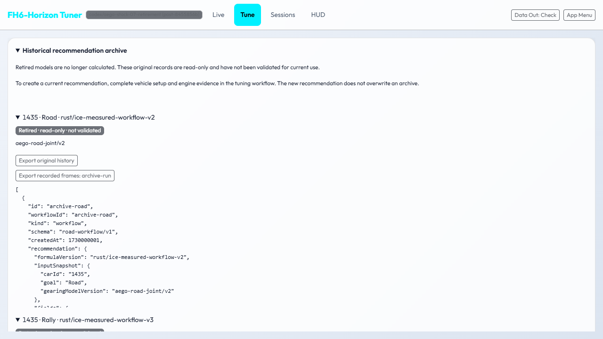 | 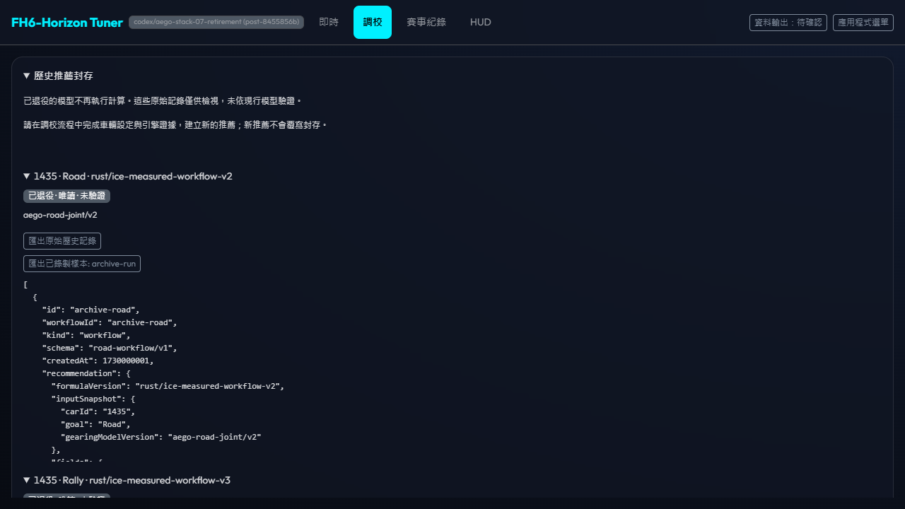 |
| Swiss Technical | 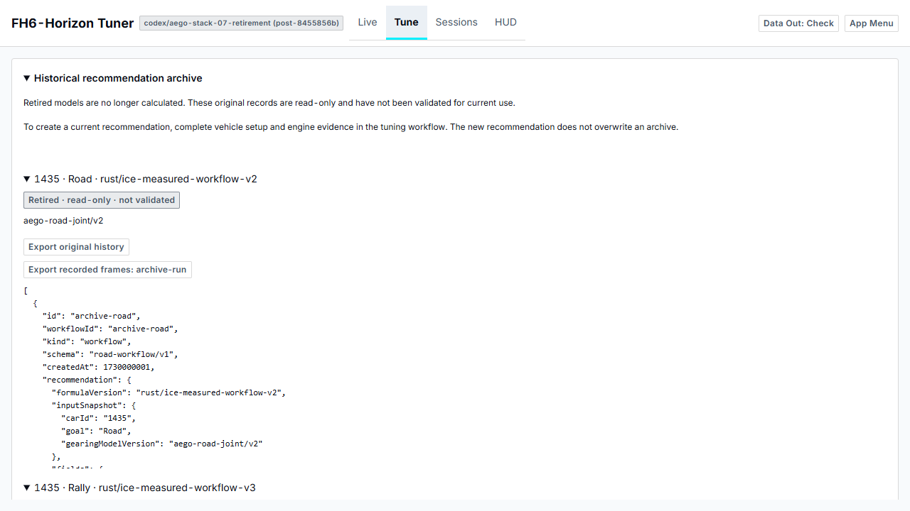 | 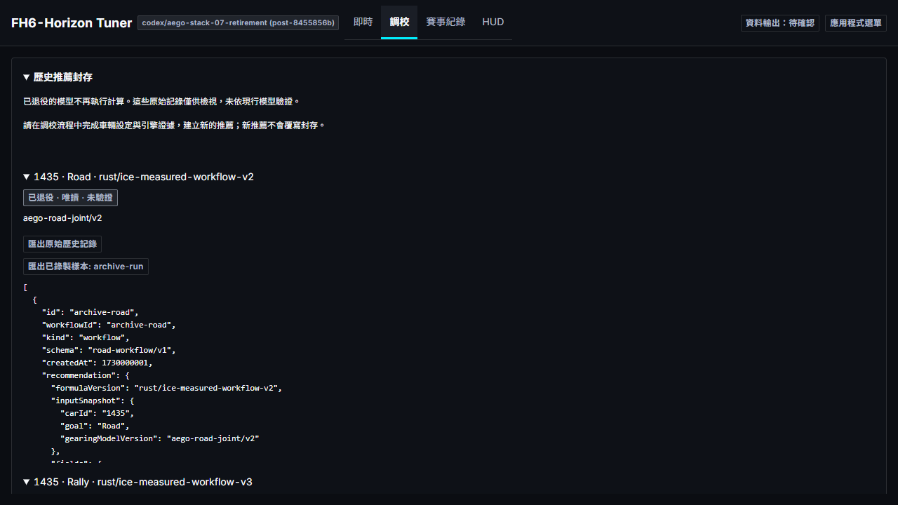 |
| Rhine Lab | 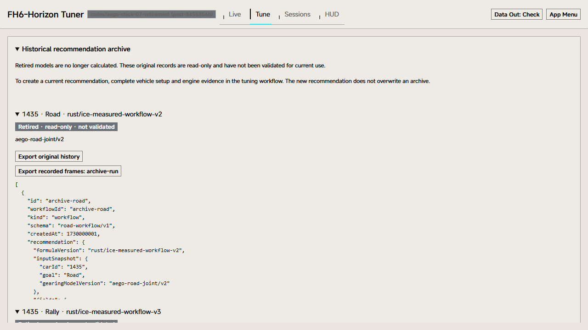 | 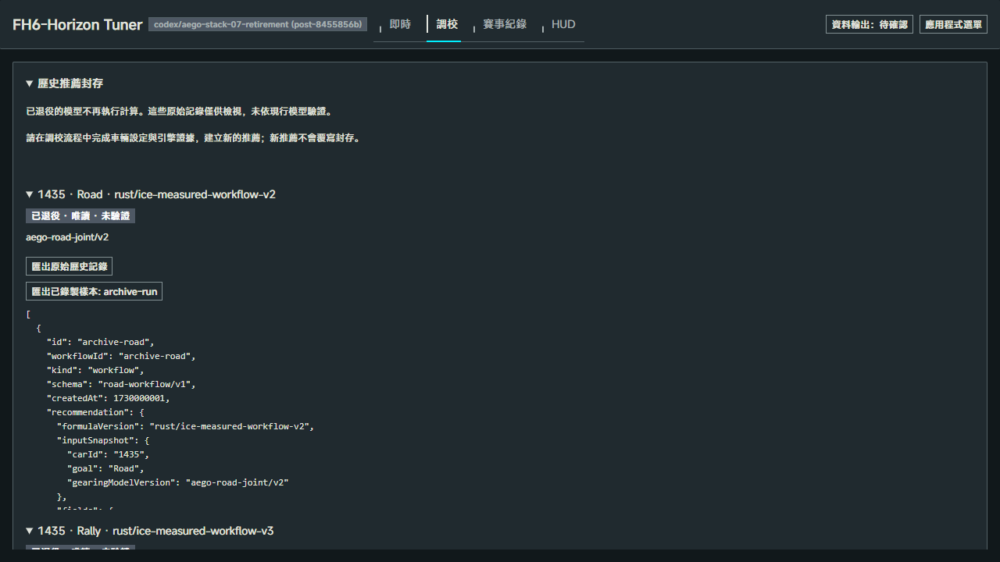 |

Step3採集工具與返回：

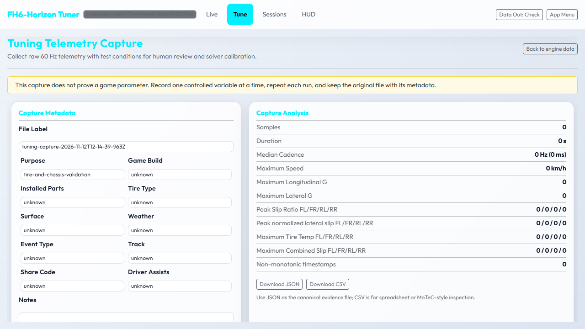

320px日文原始封存面板（較高viewport元素裁切）：

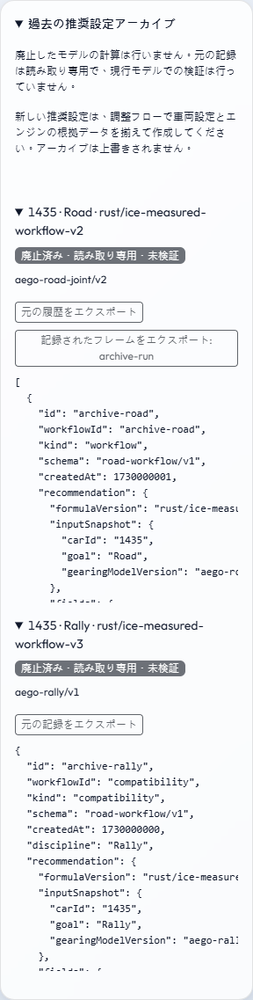

Developer Tuning移除後的設定畫面：

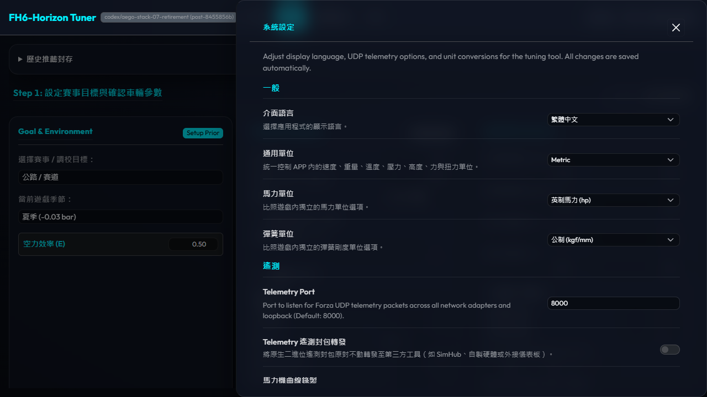

空狀態與可重試錯誤：

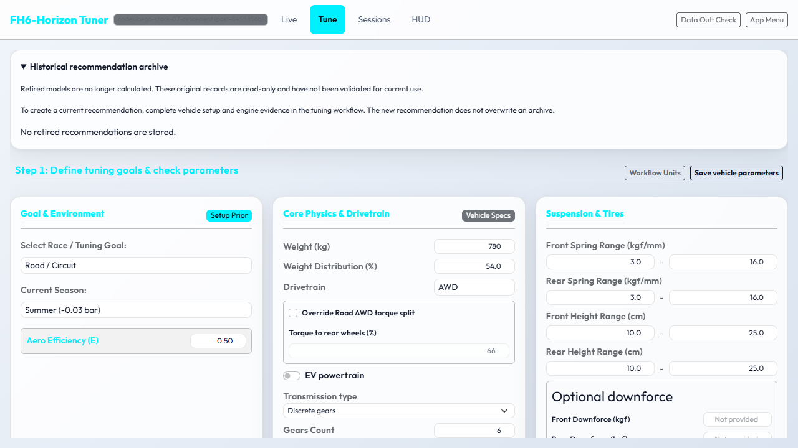
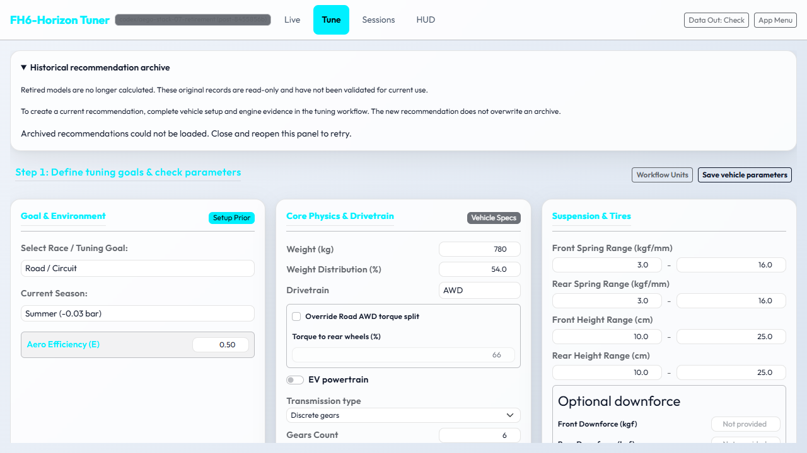
