# #678–#682 合併後補查與修復

2026-11-17，直接修復 `main`。基底為 `8d36b599`；擷取版本與實際產品檔案 blob 見 [manifest.json](manifest.json)。

| PR | 可重現遺漏 | 修復 |
| --- | --- | --- |
| #678 | 確認未關閉時，切換其他分頁／開啟對話框仍會被 window capture 攔截 Escape；非同步儲存未完成甚至失敗就公告成功 | 將 Escape 限定在確認群組；以 Promise 回傳實際儲存結果，成功才 reload／公告；儲存中防重複操作，失敗保留重試；只在本面板仍持有焦點時回復焦點 |
| #679 | 完整位元組驗證後到 `Command::spawn` 前，快取路徑仍可能被修改或替換 | Windows 開啟根目錄／版本目錄的 handle 禁止 rename，再以禁止 write/delete 的 executable handle 重驗完整位元組，保留三個 handle 到 spawn 完成；拒絕開啟的 reparse point |
| #680 | `lap_time = 0`／負值仍顯示秒數，負的最高車速仍顯示 km/h | 非正圈時與負車速顯示在地化 Unknown，保留合法零車速 |
| #681 | 有限大型數值的 `floor(max * 10) / 10` 本身仍可超過 max；NaN fallback 在最小 subnormal 鎖定範圍下會下溢成零 | floor／ceil 候選同時驗證上下界；NaN 中點先夾限再走共同捨入流程 |
| #682 | 固定 DPR 半徑大於小畫布的 padding，單點／極限行程標記被裁切 | 依兩軸可用 padding 同步縮放外環、描邊、光暈與核心；正常尺寸維持原始大小 |

`#681` 的直接產品重現：鎖定 spring／height 的 min、max 皆為 `7974024817625809`，原先回傳 `7974024817625810`。新增案例在原實作失敗，修復後所有模式皆通過。前端新增案例也先在原實作重現失敗，再驗證修復。

## 驗證

- `pnpm -C frontend run test`：228 個檔案、1681 項通過。
- `FH6_PLATFORM=windows pnpm -C frontend run build`：通過。
- `cargo test --locked --manifest-path backend-rust/Cargo.toml`：314 項通過、4 項既有忽略；21 組 tuning golden fixtures 完全未修改。
- `cargo check --locked --manifest-path backend-rust/Cargo.toml --no-default-features`：通過。
- `cargo test --locked --manifest-path backend-rust/Cargo.toml --no-default-features --lib --test tuning_contract`：35 項通過、1 項既有忽略。
- 兩個 Rust crate 的 `cargo fmt --check`、`git diff --check`：通過。
- 將實際 sidecar 函式與測試抽入 std-only harness：Linux 上完整位元組驗證／符號連結案例共 2 項通過；Windows 鎖定／真實可執行檔啟動測試完成 `rustc --test --emit=metadata --target x86_64-pc-windows-gnu` 型別檢查。
- `cargo test --locked --manifest-path frontend/src-tauri/Cargo.toml --lib` 因此 Linux 環境缺少 GTK/WebKit 開發庫而無法完成。**Windows 原生鎖定與啟動測試尚未執行，不將交叉型別檢查視為 Windows 執行驗收。**

## 瀏覽器畫面

使用正式應用容器與樣式，API 資料為無敏感 fixture。六組主題／語系的互動檢查結果保存在 [browser-results.json](browser-results.json)，HUD 的實際尺寸見 [hud-results.json](hud-results.json)。

| 主題 | 儲存中的重設確認 | 無效圈時與車速 |
| --- | --- | --- |
| Default 淺色／英文 | 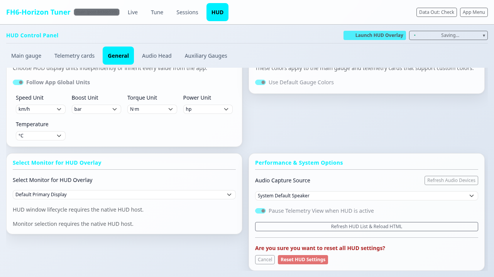 | 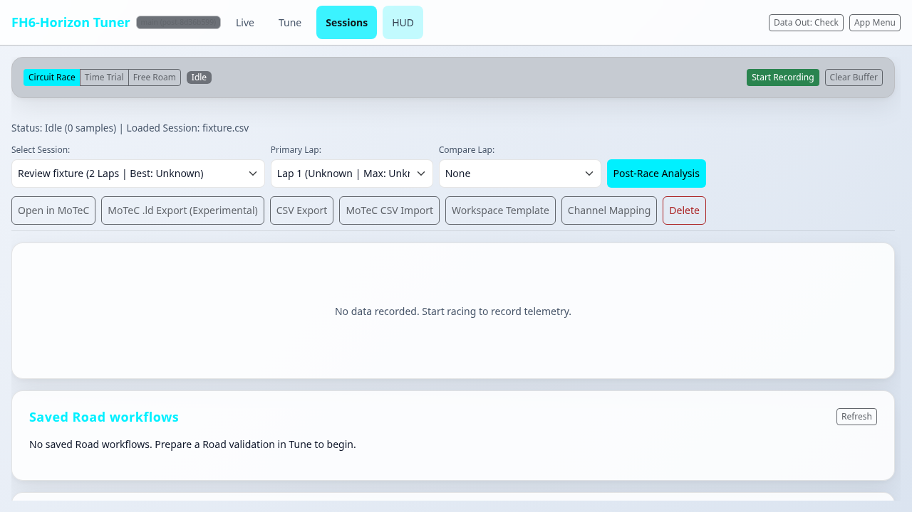 |
| Default 深色／繁中／320px | 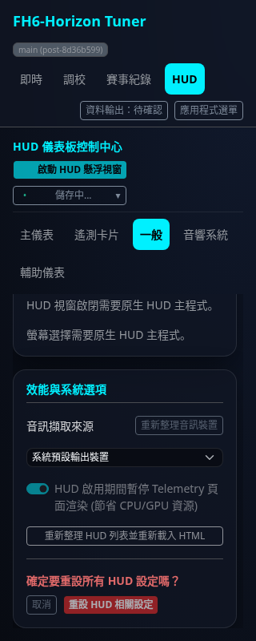 | 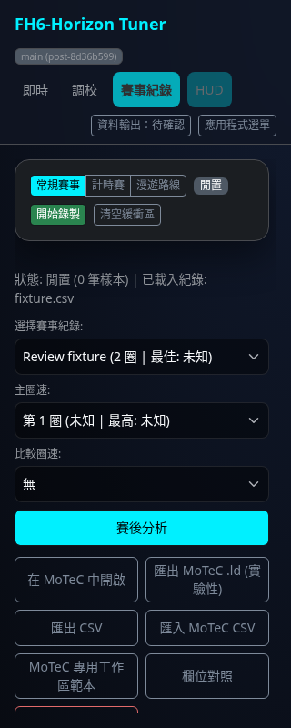 |
| Swiss 淺色／繁中 | 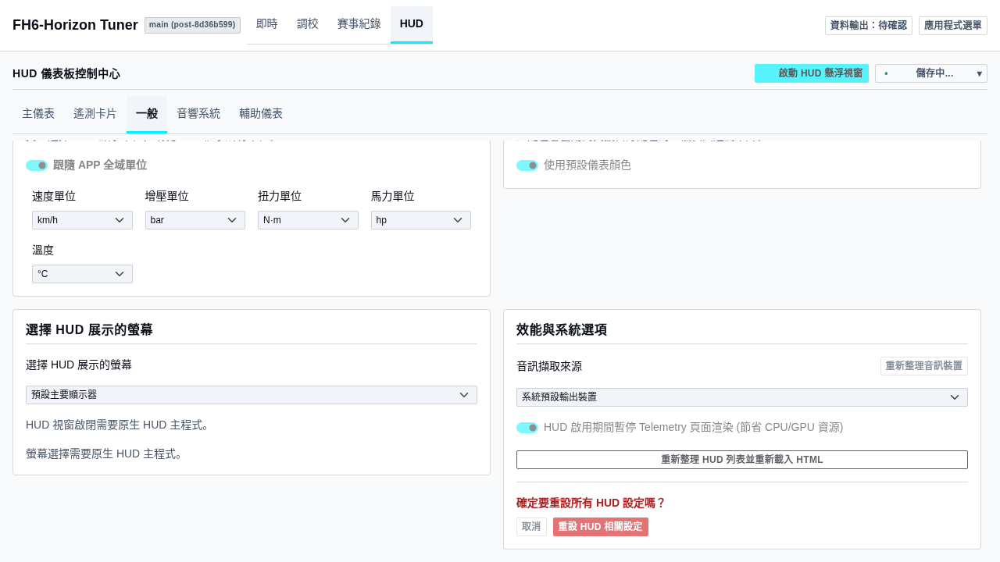 | 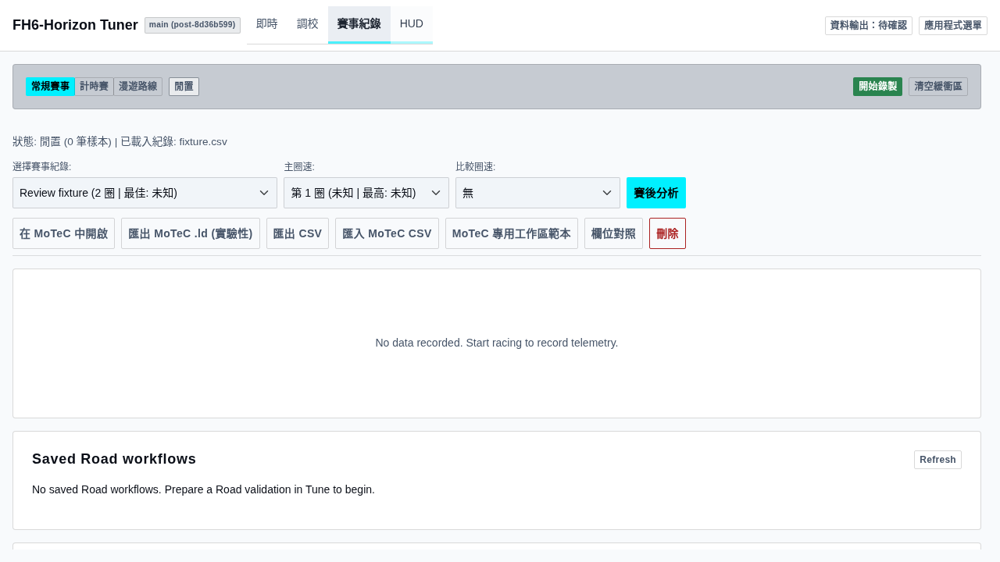 |
| Swiss 深色／日文 | 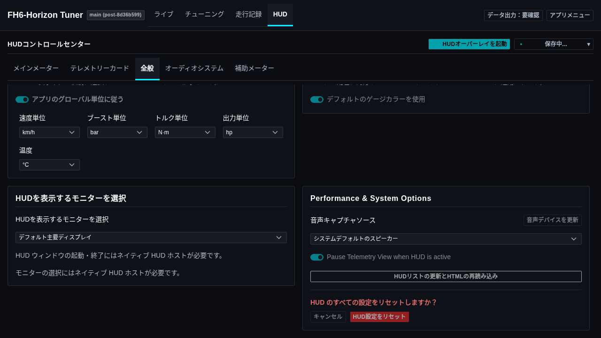 | 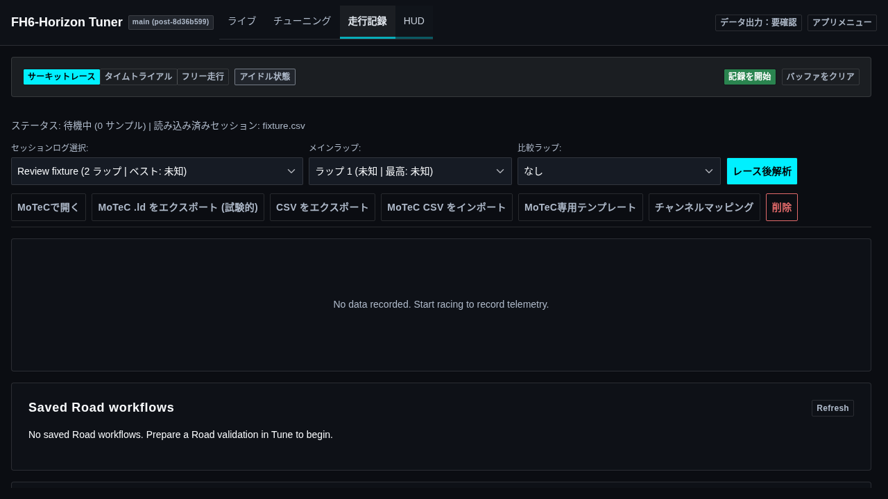 |
| Rhine Lab 淺色／日文 | 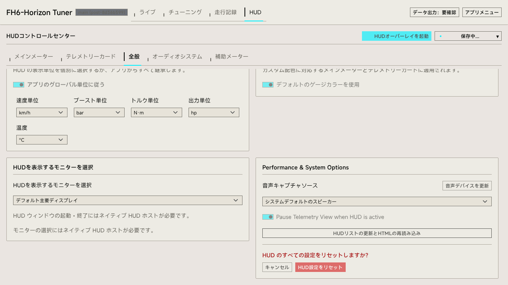 | 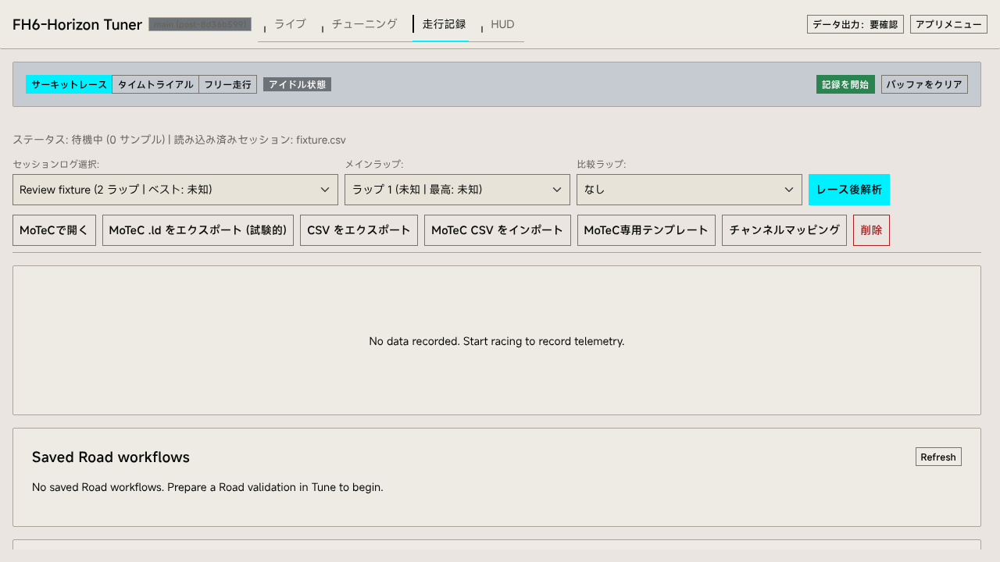 |
| Rhine Lab 深色／英文 | 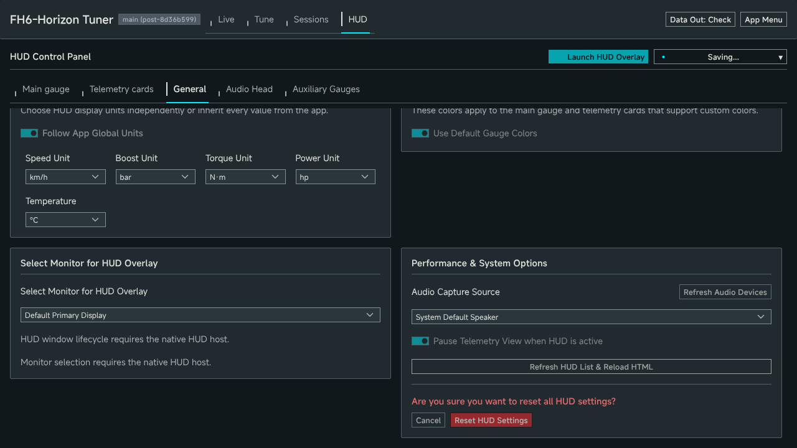 | 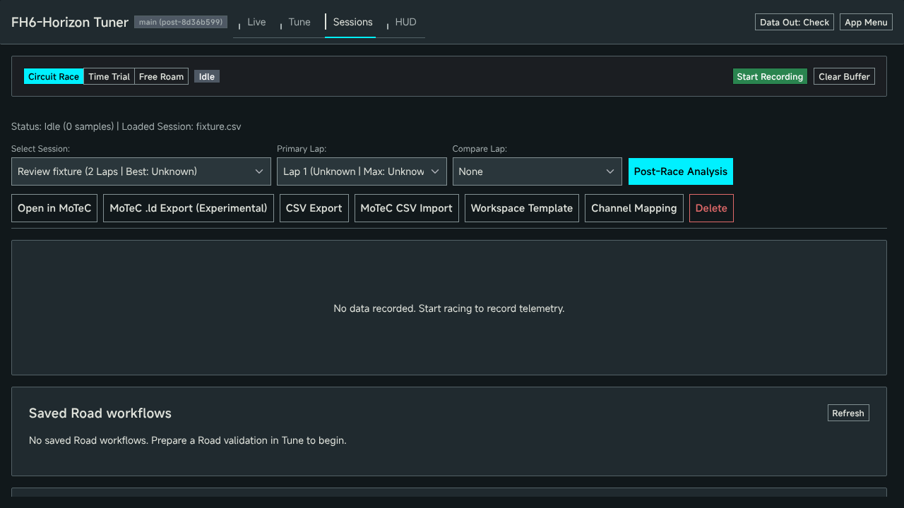 |

懸吊 renderer 元素裁切，以行程 1.0 的壓縮極限測試；小視窗保留實際窄卡片與文字裁切，檢查範圍僅為畫布標記。

| Viewport／DPR | 實際 renderer |
| --- | --- |
| 1280×720／1 | 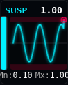 |
| 640×180／1 |  |
| 640×180／2 |  |

## 重現

先建置 Windows 前端目標，再於 repository 根目錄執行：

```sh
pnpm -C frontend exec vite preview --host 127.0.0.1 --port 1453
```

另一個 shell 執行 `node docs/visual-review/main-678-682-followup/capture-app.mjs` 與 `capture-hud.mjs`。需要 Playwright 與 Chromium；可透過 `FH6_PLAYWRIGHT_MODULE` 指定 Playwright 模組路徑／specifier，`FH6_CHROMIUM` 指定瀏覽器路徑。腳本會重新擷取本目錄圖片及結果 JSON。重新擷取時需同步更新 manifest 的程式碼版本。

未驗證 Windows overlay、實際遊戲或讀屏器，也未覆蓋三個代表 core 之外的其他 core。這些截圖不代表原生、效能或小視窗完整排版驗收。
