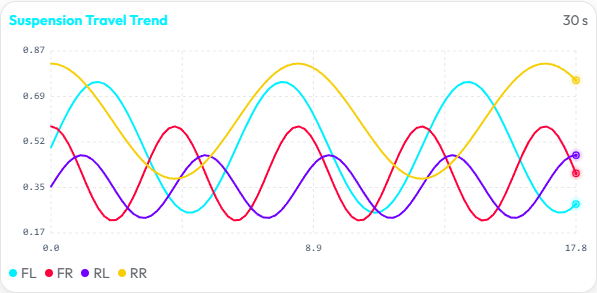
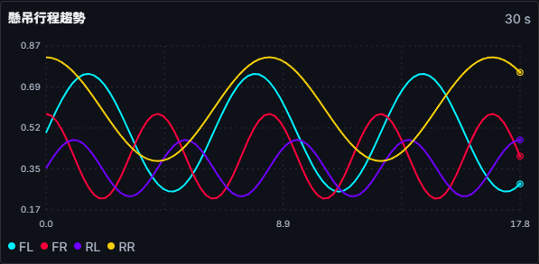
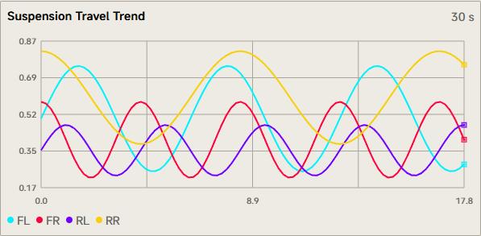
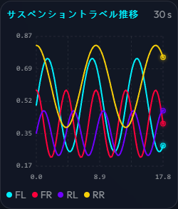

# PR #644 視覺備查

2026-11-10，以 Windows Chromium 148.0.7778.96／Playwright 1.65.0 擷取，使用正式 AppShell、providers、主題與 TrendChart。資料為 route-isolated HTTP fixture 與直接送入既有 telemetryHistoryStore 的 90 筆合成歷史；目前即時數值未輸入，因此畫面上的 current 指標顯示 --。沒有修改產品 CSS 或隱藏工具列。

實作版本：`0aeaa6e2c956d433c895d83353d93f107055a94a`；後續僅增加本備查、擷取腳本與圖片，renderer 相同。完整版本、blob 與每個案例見 [manifest.json](manifest.json)。

- 7 個 core 各檢查日／夜共 14 組，交錯使用繁中／英文／日文與 reduced motion。Halfmoon Default、Swiss Technical、Rhine Lab 各保留日夜畫面。
- 3 系統另檢查 320×720 窄幅，保存整頁與標明 chart- 前綴的元素裁切。其餘代表圖 viewport 為 1280×720；DPR 1、zoom 100%，沿用應用程式背景。
- 懸吊、輪胎 5 種趨勢、動態 6 種趨勢均透過正式 panel 呈現，輪胎與動態另存每張 chart 裁切。整頁保存實際捲動位置，沒有放大 viewport 來冒充可見性。
- 檢查端點圓／方形、發光／flat 抑制、曲線線寬、文字與圖例、窄幅裁切、文件水平 overflow；17 組無 pageerror，chart 都有像素輸出。
- [renderer-checks.json](renderer-checks.json) 記錄真實 Canvas 的像素回歸：第二條曲線與單獨繪製的同一曲線像素相同；caller 線寬與陰影在繪製後完整還原。Vitest 驗證正常與例外路徑狀態還原，不計數 Canvas API。
- 靜態合成資料與截圖不證明實際遊戲、原生桌面、讀屏、FPS 或 GC 表現。沿用原有 layout 配置，僅端點標記沒有新增 point／Path2D 暫態物件；不宣稱整個 render 零配置。

## 重現

1. `pnpm install --frozen-lockfile`。
2. 在 repository 根目錄執行 `npm install --prefix scratch/browser-tools --no-save --no-package-lock playwright-core@1.65.0`，並將兩個腳本的 Chromium 路徑設為已安裝的 Chromium。
3. 在 frontend 啟動 `node node_modules/vite/bin/vite.js --port 1434`。
4. 根目錄執行 `node scripts/capture_pr644.cjs` 擷取主題矩陣；需要輪胎與動態裁切時，設定 `FH6_CAPTURE_DETAIL_PANELS=1` 再執行。這些 crop 的 viewport／主題條件與第一組 default light 相同。
5. 執行 `node scripts/check_pr644_renderer.cjs` 驗證像素與狀態回歸。依 manifest 檢視圖片。

代表：

署名：Jonas as Codex
