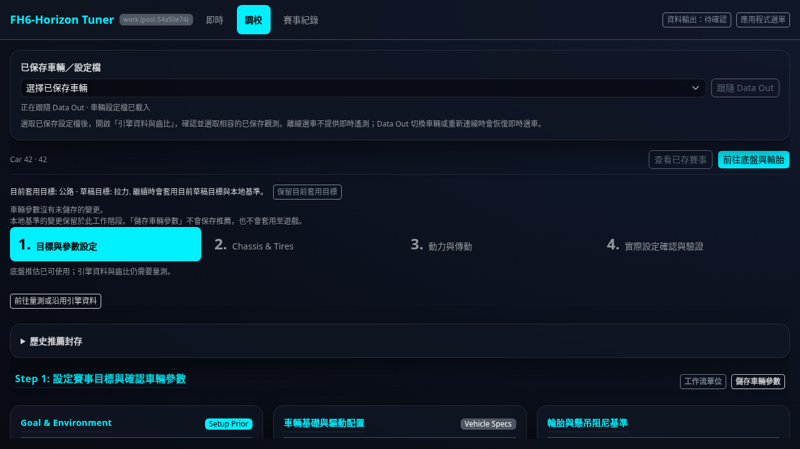
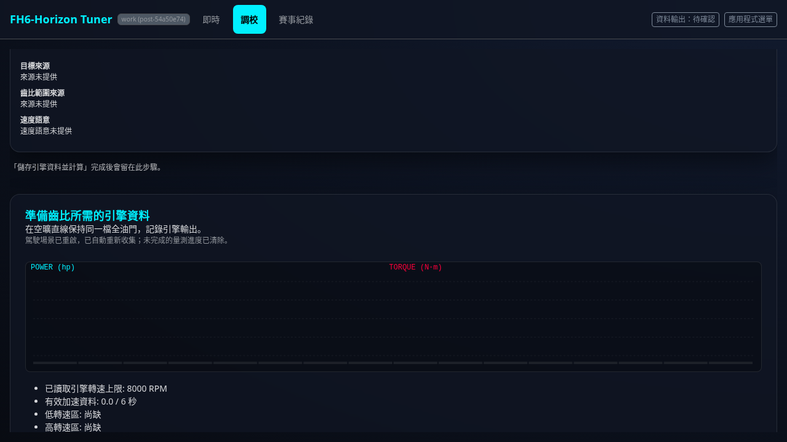
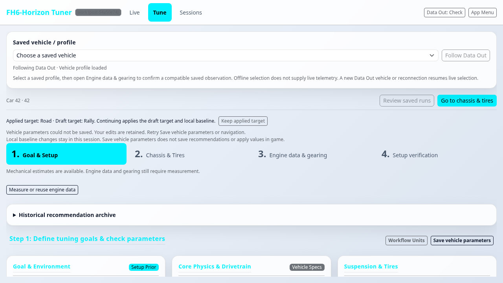
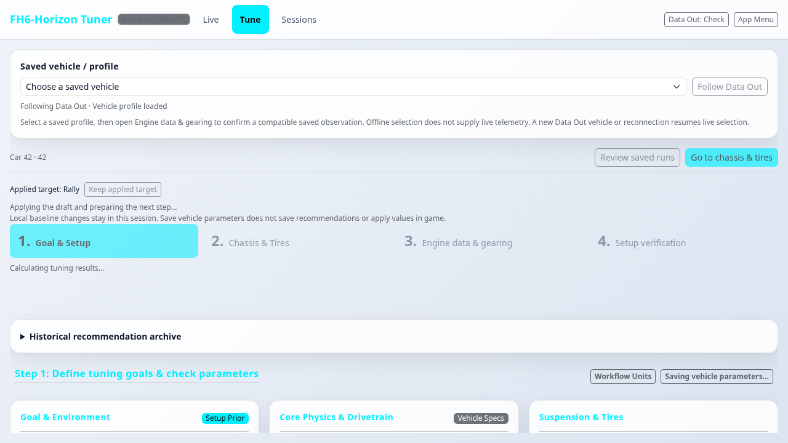
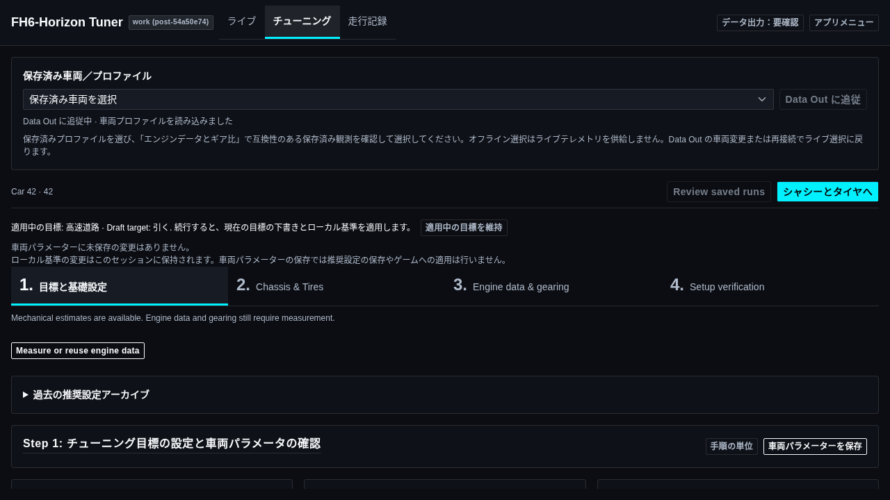
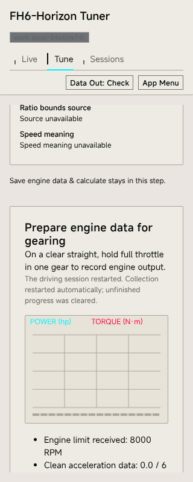

# 草稿前進與量測恢復：視覺審查

- 日期：2026-11-18（Asia/Taipei）。基底為 `54a50e74`，加上本次尚未提交的修正；完整時間、來源檔 SHA-256 見 [source-manifest.json](source-manifest.json)。
- 平台：Linux Chromium headless，正式 React AppShell／providers 與 Rust HTTP API；Data Out 為合成的同車靜止封包，非真實遊戲連線。後端資料目錄為獨立的 `/tmp/fh6-tuning-visual-data`，不使用玩家設定。
- 覆蓋 Halfmoon Default、Swiss Technical、Rhine Lab 日夜模式；繁中／英文／日文；1280×720 及 320×800。固定 reduced motion。這次不改其他 core 的 CSS；其他 core 未逐一驗收。
- 每組驗證選 Rally 後直接前進到 Step2，再進入 Step3，連續兩次重設時鐘後能持續收集。另保留儲存失敗與等待新計算結果的畫面。
- [browser-results.json](browser-results.json) 記錄各組頁面寬度與前端執行錯誤。截圖保留正式容器及捲動位置，未修圖或覆寫排版；部分 Step3 圖為頁面捲到量測面板的狀態。
- 未涵蓋：真實遊戲車庫／傳送封包、Windows Tauri 原生視窗、手機、讀屏軟體與動畫表現。既有未翻譯字串的英文回退可見於圖片，本次新增提示已提供三語翻譯。

## 代表畫面

| 狀態 | 畫面 |
| --- | --- |
| 繁中草稿可直接前進 |  |
| 繁中自動重新準備 |  |
| 儲存失敗保留草稿 |  |
| 套用後等待新結果 |  |
| Swiss 日文 |  |
| Rhine 窄幅 |  |

完整圖片依 `<core>-<mode>-<language>-<width>-<state>.png` 命名。

## 重現入口

1. 啟動本次 Rust sidecar，指定獨立資料目錄，HTTP port 為 8001；以 `/api/car_params/42` 儲存車重 1400、前軸配重 48、300 hp、400 N·m、前後彈簧範圍 30–100、六檔可調變速箱的合成車輛設定。
2. 啟動前端 Vite，port 為 1453。
3. 執行 `node docs/visual-review/tuning-navigation-recovery/capture.mjs`。可用 `FH6_PLAYWRIGHT_MODULE`、`FH6_CHROMIUM` 與 `FH6_REVIEW_URL` 指定瀏覽器工具及前端網址。

腳本透過瀏覽器攔截語系與遙測傳輸，使用真實 Rust workflow／profile API。唯一模擬的錯誤是第一組的參數儲存失敗；等待畫面則延後正式計算請求，不偽造成功結果。
